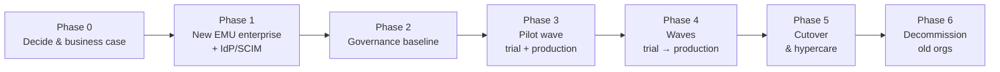

# Migrating from GitHub.com to GitHub Enterprise Managed Users (EMU)

A complete, step-by-step guide for organizations moving their GitHub estate from **GitHub.com (personal accounts)** to a **GitHub Enterprise Cloud enterprise with Enterprise Managed Users (EMU)** – on GitHub.com or on **GHE.com** (data residency). It covers the **technical**, **organizational**, **identity**, **governance/security** and **change-management** aspects, and includes the benefits of EMU, a catalogue of pitfalls, and a printable checklist.

> Last verified: 2026-10-15 against GitHub Docs. See [docs/09](docs/09-references-and-research-notes.md) for sources and what to re-verify before you start.

## Start here

| If you are… | Read first |
|---|---|
| An executive / sponsor deciding **whether** to migrate | [01 – Why migrate to EMU](docs/01-why-migrate-to-emu.md) → [02 – Fundamentals & decision guide](docs/02-emu-fundamentals-and-decision-guide.md) |
| A program/project manager | [03 – Strategy & planning](docs/03-migration-strategy-and-planning.md) → [Checklist](checklists/migration-checklist.md) |
| An identity / IAM engineer | [04 – Identity & access](docs/04-identity-and-access.md) |
| A security / compliance / governance lead | [05 – Governance, security & compliance](docs/05-governance-security-compliance.md) |
| A migration engineer | [06 – Technical migration guide](docs/06-technical-migration-guide.md) |
| A change / support / developer-experience lead | [07 – Post-migration & change management](docs/07-post-migration-and-change-management.md) |
| Anyone doing a risk review | [08 – Pitfalls & mitigations](docs/08-pitfalls-and-mitigations.md) |

## Document map

| # | Document | Purpose |
|---|---|---|
| 01 | [Why migrate to EMU](docs/01-why-migrate-to-emu.md) | Benefits, comparison with personal accounts, trade-offs, business-case template |
| 02 | [EMU fundamentals & decision guide](docs/02-emu-fundamentals-and-decision-guide.md) | How EMU works, GitHub.com vs GHE.com, restrictions, decision questionnaire, irreversible decisions |
| 03 | [Migration strategy & planning](docs/03-migration-strategy-and-planning.md) | Phased roadmap, governance of the program, RACI, inventory, waves, risks, KPIs |
| 04 | [Identity & access](docs/04-identity-and-access.md) | IdP, SAML/OIDC, SCIM, shortcode & usernames, groups → teams, lifecycle, service accounts |
| 05 | [Governance, security & compliance](docs/05-governance-security-compliance.md) | Enterprise policies, rulesets, GHAS, audit, compliance, licensing and billing |
| 06 | [Technical migration guide](docs/06-technical-migration-guide.md) | GitHub Enterprise Importer runbook: prerequisites, trial run, production run, follow-up tasks |
| 07 | [Post-migration & change management](docs/07-post-migration-and-change-management.md) | Cutover, validation, developer onboarding, communications, hypercare, decommissioning |
| 08 | [Pitfalls & mitigations](docs/08-pitfalls-and-mitigations.md) | 30+ pitfalls with likelihood/impact, mitigation and early-warning signs |
| 09 | [References & research notes](docs/09-references-and-research-notes.md) | Sources, key findings, limits of the research, glossary |
| ✔ | [Migration checklist](checklists/migration-checklist.md) | End-to-end checklist with gates and owner roles |

## The migration in one picture

## Key facts to remember

- **EMU needs a new enterprise.** An existing enterprise with personal accounts cannot be converted; you migrate into a new EMU enterprise (e.g. with GitHub Enterprise Importer, `gh gei`).
- **Irreversible choices:** enterprise type, the **shortcode** (GitHub.com), and the data-residency region/hosting model. Decide them deliberately.
- **Managed users live inside the enterprise.** No public repos or gists, no contributions/forks/stars outside the enterprise – developers who contribute to open source need a separate personal account.
- **Identity first:** provision users and groups via SCIM and validate usernames/emails **before** migrating repositories.
- **GEI has no delta migration**; run a **trial** in a sandbox organization, freeze changes for production, then complete the follow-up tasks (webhooks, Apps, Actions secrets/runners, LFS, teams, mannequins).
- **Not everything migrates** – Actions secrets, Packages, new Projects, repo Discussions, rulesets, stars/watchers, forks relationships and more must be handled separately (see [06](docs/06-technical-migration-guide.md)).

## Conventions used in these documents

- 🔒 irreversible/hard-to-reverse action · 🚦 go/no-go gate · ⚠️ risk · ✅ supported · ❌ not supported.
- Commands use placeholders in `UPPER-CASE` (for example `SOURCE-ORG`, `DEST-ORG`, `SUBDOMAIN`). Replace them with your values and **never commit tokens**.
- Where a statement could not be verified in official documentation it is flagged *"verify with GitHub documentation/Support"*.
- Diagrams use [Mermaid](https://mermaid.js.org/), which renders natively on GitHub.

## Roadmap for this repository

Follow-up deliverables planned after this markdown baseline: a **presentation deck** and a **PDF/Word work document** generated from these files. Keep the markdown as the single source of truth.

## Contributing

Corrections and updates are welcome via pull request. When you change a fact, update the "Last verified" note and the [research notes](docs/09-references-and-research-notes.md), and cite the official GitHub documentation page.

## License

See [LICENSE](LICENSE).
