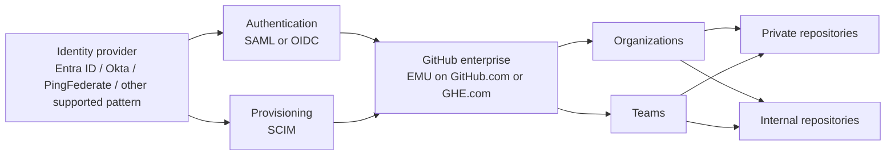
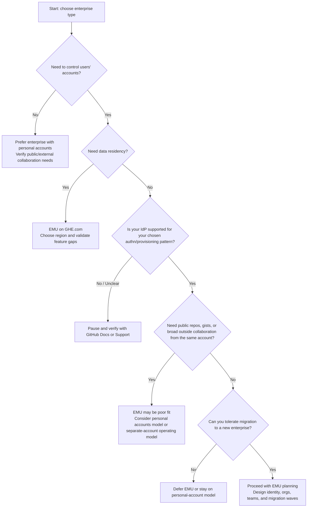

# EMU fundamentals and decision guide

This guide explains how GitHub Enterprise Managed Users (EMU) works, what technical and operating-model constraints come with it, and how to decide whether EMU is the right enterprise type before you commit to a migration program.

> Last verified: 2026-10-15 against GitHub Docs

## Table of contents

- [Executive overview](#executive-overview)
- [How EMU works](#how-emu-works)
  - [Core operating model](#core-operating-model)
  - [Reference architecture](#reference-architecture)
  - [Setup essentials](#setup-essentials)
- [Hosting options](#hosting-options)
- [Supported IdPs](#supported-idps)
- [Abilities and restrictions of managed users](#abilities-and-restrictions-of-managed-users)
- [Decision questionnaire](#decision-questionnaire)
- [Scoring guidance](#scoring-guidance)
- [Decision tree](#decision-tree)
- [Key irreversible decisions](#key-irreversible-decisions)
- [Target architecture options](#target-architecture-options)
  - [Single enterprise vs multiple enterprises](#single-enterprise-vs-multiple-enterprises)
  - [Organization structure principles](#organization-structure-principles)
- [Implementation reminders](#implementation-reminders)
- [Official documentation](#official-documentation)

## Executive overview

EMU is a GitHub Enterprise Cloud model in which your identity provider (IdP) manages user lifecycle and authentication. GitHub Docs state that the IdP provisions accounts with SCIM, users authenticate on the IdP with SAML or OIDC, and the IdP controls usernames, profile data, organization membership, and repository access.

That gives the enterprise more control than the personal-account model, but it also changes the collaboration boundary:

- Managed users cannot create public content.
- Managed users cannot collaborate outside the enterprise.
- Organizations in an EMU enterprise can use only private and internal repositories.
- Existing enterprises that use personal accounts cannot be converted in place; adopting EMU requires a migration to a **new** enterprise account.

GitHub Docs also state that EMU is not the best solution for every customer. The rest of this guide is designed to help you decide before you provision the target environment.

## How EMU works

### Core operating model

At a high level, EMU turns GitHub into an enterprise-managed application in the same way as other centrally governed SaaS platforms:

1. The enterprise creates a **new** GitHub enterprise account configured for EMU.
2. A single non-SCIM **setup user** is used for initial bootstrap tasks.
3. The IdP is configured for authentication.
4. The IdP is configured for SCIM provisioning.
5. Users are provisioned as managed accounts.
6. Teams can be synchronized to IdP groups.
7. Repository access is granted in GitHub to those teams.

Key consequences of that model:

- Users do not manage passwords or GitHub-native 2FA on the managed account.
- Profile name and email come from the IdP and cannot be changed on GitHub.
- The IdP can provide only one email address for a managed account.
- Deprovisioning suspends the account and invalidates sessions.
- Reassignment restores the account and original username.

### Reference architecture

Interpretation:

- **Authentication** establishes who the user is.
- **SCIM** establishes whether the user exists and what role the account has.
- **GitHub** remains the place where repository permissions are applied to organizations and teams.
- **Internal repositories** are the main enterprise-wide InnerSource mechanism in EMU.

### Setup essentials

GitHub Docs describe several bootstrap details that matter later:

- The setup user is named `shortcode_admin` on GitHub.com examples.
- It is the only non-SCIM user in the enterprise.
- GitHub recommends setting its password in an incognito window, enabling 2FA, saving recovery codes, downloading enterprise SSO recovery codes, and storing credentials in a password manager.
- For SCIM configuration, GitHub Docs describe creating a classic PAT for the setup user with at least `scim:enterprise` scope and no expiration.

Shortcode and username facts to plan for on GitHub.com:

- The shortcode is 3 to 8 alphanumeric characters.
- The shortcode is chosen by you.
- The shortcode cannot be changed after creation.
- Managed usernames are formed from the IdP username plus the enterprise shortcode.
- The maximum username length is 39 characters including the suffix on GitHub.com.

For `ghe.com` data residency environments:

- GitHub assigns a dedicated subdomain: `SUBDOMAIN.ghe.com`.
- The API base becomes `https://api.SUBDOMAIN.ghe.com`.
- The shortcode is random and hidden.
- The username limit drops from 39 to 30 characters.

> **Warning**
> Name, email, username rules, and API endpoint changes affect automation, commit attribution, onboarding instructions, and migration tooling. Treat identity design as an early workstream, not a post-cutover cleanup item.

## Hosting options

GitHub Docs support two EMU hosting patterns relevant here: GitHub.com and GitHub Enterprise Cloud with data residency (`ghe.com`).

| Topic | GitHub.com with EMU | `ghe.com` with data residency |
| --- | --- | --- |
| Enterprise type | EMU available for new GitHub Enterprise Cloud enterprises | EMU required |
| Domain model | GitHub.com | `SUBDOMAIN.ghe.com` |
| API base URL | Standard GitHub.com API | `https://api.SUBDOMAIN.ghe.com` |
| Data residency | Not the data-residency offering | Regional data residency offering |
| Regions | N/A in this context | EU, Australia, US, Japan |
| Shortcode | Chosen by customer; 3-8 alphanumeric; immutable | Random and hidden |
| Username length | Up to 39 characters including shortcode suffix | Up to 30 characters |
| Network details | Standard GitHub.com ranges and fingerprints | Different IPs and SSH fingerprints from GitHub.com |
| Marketplace | Standard GitHub.com pattern | GitHub Marketplace unavailable |
| Copilot | Managed users need Copilot Business or Enterprise | Managed users need Copilot Business or Enterprise; extra IDE auth setup; some Copilot features unavailable |
| Feature caveats | EMU restrictions still apply | EMU restrictions plus `ghe.com` feature differences |

Current `ghe.com` feature differences called out in the verified fact set:

| `ghe.com` item | Status / note | Migration or design implication |
| --- | --- | --- |
| Dependency insights at org/enterprise level | Currently unavailable | Verify whether existing dashboards rely on it |
| macOS GitHub-hosted runners | Currently unavailable | Review Apple-platform CI design |
| Maven and Gradle in GitHub Packages | Currently unavailable | Verify package-hosting requirements |
| GitHub Marketplace | Unavailable | Review paid app and integration strategy |
| Some preview features | May be unavailable | Verify feature dependencies before choosing region |
| Streaming audit logs to Amazon S3 with OIDC | Currently unavailable | Verify audit export requirements |
| EMU-unavailable features such as public repos and gists | Permanently unavailable in the EMU model | Update collaboration model and developer guidance |

> **Note**
> Before choosing `ghe.com`, validate every platform dependency against the current GitHub Docs feature overview and, where needed, GitHub Support. Do not assume GitHub.com feature parity.

## Supported IdPs

GitHub Docs describe a paved path for three partner IdPs and a more cautious path for others.

| IdP | Authentication support | Provisioning support | Notes |
| --- | --- | --- | --- |
| Microsoft Entra ID | SAML and OIDC | SCIM | GitHub recommends OIDC for Entra because it supports Conditional Access Policy. If you use multiple enterprises from one tenant, the first can use SAML or OIDC, but additional enterprises must use SAML. |
| Okta | SAML only | SCIM | OIDC is not supported in the verified fact set. |
| PingFederate | SAML only | SCIM | OIDC is not supported in the verified fact set. |
| Other IdPs | Must support SAML 2.0 and SCIM 2.0 integration pattern | Usually via GitHub REST API for SCIM | Verify with GitHub documentation and GitHub Support before committing to production. |

Important support boundaries from GitHub Docs:

- Use a **single partner IdP** for both authentication and provisioning for full support.
- A mixed **Okta + Entra ID** design is explicitly **not supported** because it can produce SCIM API errors.
- REST API SCIM provisioning is **not supported** with enterprises enabled for OIDC.
- GitHub Docs note that support may be limited for mixed or untested IdP combinations.

> **Warning**
> IdP design should be treated as a go/no-go criterion. If your identity architecture needs a mixed or untested pattern, verify it with GitHub documentation and GitHub Support before provisioning the enterprise.

## Abilities and restrictions of managed users

The table below summarizes the most important EMU behavior changes and adds a migration-focused interpretation.

| Area | Ability / restriction | Migration impact | Mitigation / design response |
| --- | --- | --- | --- |
| Repository contribution | Managed users can contribute only to private and internal repositories in the enterprise and their own private repositories | Public-repo contribution from the managed identity stops | Keep or require separate personal accounts for external/open-source work |
| Public GitHub | Managed users have read-only access to public GitHub | Developers may assume they can still interact publicly, but they cannot | Train users on account boundaries and browser/Git switching |
| Authentication | Authentication happens only via the IdP; no GitHub password or GitHub-native 2FA on the managed account | Support flows change | Align IAM support, MFA messaging, and recovery procedures |
| Username and email | Name and email come from the IdP and cannot be changed on GitHub; only one email is supported | Commit attribution and directory quality become critical | Normalize IdP attributes and commit email strategy before cutover |
| Deprovisioning | IdP deactivation suspends the account, invalidates sessions, and changes the username to a hash plus shortcode; reactivation restores it | Offboarding gets stronger but automation must be trusted | Test suspend/restore workflows before production migration |
| Outside collaboration | Managed users cannot collaborate outside the enterprise | Vendor, partner, and OSS workflows may break if not redesigned | Identify external-collaboration use cases early and move them to personal accounts or alternative patterns |
| Public content | Managed users cannot create public repositories or gists | OSS publishing from the managed identity is blocked | Publish from approved personal or non-EMU workflows where policy allows |
| Repository visibility | Organization repositories in EMU can be private or internal only | Existing public repositories cannot remain public after EMU migration | Reclassify or redesign publishing strategy |
| Forking | Managed users cannot fork repositories from outside the enterprise | External contribution workflows change | Use separate personal accounts or enterprise-owned mirrors where appropriate; verify with policy |
| Visibility and mentions | Managed users are visible only to enterprise members and cannot be mentioned or invited by other GitHub users | Cross-enterprise social workflows disappear | Reset stakeholder expectations; use other channels for external coordination |
| User-owned repositories | Policy can allow user-owned repos, but they are private only and can invite only enterprise members | Personal sandbox patterns change | Decide whether to allow user-owned repos at all |
| Teams via IdP groups | Group-to-team sync supported; one group per team; same group can map to multiple teams; synced teams cannot be parent/child; team maintainer cannot be set on synced teams | Existing team structures may need redesign | Flatten team hierarchy where needed and define GitHub vs IdP ownership clearly |
| Team sync prerequisites | Existing team must have manual members removed first; membership managed only in IdP afterward | Team cutover requires prep work | Schedule team cleanup and source-of-truth change control |
| Entra group limits | Only security groups, no nested groups, no Microsoft 365 groups | Group model may not match current Entra design | Refactor groups before EMU rollout |
| Guest collaborator role | Guest collaborators cannot access internal repos except in orgs where added as members | Internal-repo sharing strategy may not fit guest access assumptions | Use private repos where narrower sharing is required |
| Internal repositories | Visible to all enterprise members | Good for InnerSource, but broad visibility may surprise some teams | Define clear internal/private repo classification rules |
| GitHub Apps on user accounts | Managed users cannot install apps on their user accounts except privileged apps | User-level tooling patterns may fail | Prefer org-installed apps and review permissions early |
| GitHub Apps on repos and orgs | Users can install some apps on repos if the app has no org permissions and user has admin; org owners can install on orgs; paid apps only by enterprise owner | App rollout governance becomes more centralized | Create an app approval process and inventory existing dependencies |
| GitHub Apps / OAuth apps creation | Managed users can create GitHub Apps and OAuth apps | Governance is still required | Define who may create integrations and where they are installed |
| Actions | Managed users cannot create workflow templates; GitHub-hosted runners are not available for repos owned by managed users | User-owned CI patterns may break | Keep CI in org-owned repos; standardize template ownership in orgs |
| Codespaces | Only enterprise-owned codespaces; not for personal repos, outside repos, or public templates; users cannot publish a template codespace to a new repo | Existing education or prototyping patterns may need rework | Keep Codespaces aligned to enterprise-owned repos |
| Copilot | Managed users cannot use Copilot Pro or Free; they need Copilot Business or Enterprise; Copilot cloud agent is not available in personal repos of managed users | Licensing and enablement must change | Plan license assignment and developer communications |
| Pages | Pages are limited for EMU | Existing Pages usage may need redesign | Verify current Pages dependency with GitHub documentation |
| Packages and storage | No individual storage allocation and no user-level package publishing | User-owned package workflows may fail | Move packages to org-owned repositories and registries |
| Profiles and gists | No personalized profiles and no gists | Developer habits change | Document replacements such as internal docs or repos |
| Certifications | No GitHub Certifications for managed users | Usually low migration impact | Communicate only if relevant to your programs |

## Decision questionnaire

GitHub Docs present six essential questions for choosing an enterprise type. Use them as the core decision workshop.

| Question | Why it matters | EMU signal |
| --- | --- | --- |
| Do you need to control users' GitHub accounts? | This is the main distinction between personal-account enterprises and EMU | If **yes**, EMU gets stronger |
| Do you need data residency? | `ghe.com` requires EMU | If **yes**, EMU gets much stronger |
| Is your IdP supported? | Identity architecture is a hard dependency | If **no** or **unclear**, pause until verified |
| Do you need public repositories, gists, or GitHub Pages patterns that conflict with EMU restrictions? | EMU blocks public repos and gists, and Pages is limited | If **yes**, EMU gets weaker unless you redesign workflows |
| Do you need collaboration outside the enterprise from the same account? | Managed users cannot collaborate outside the enterprise | If **yes**, EMU gets weaker unless separate personal accounts are acceptable |
| Can you tolerate the migration cost? | EMU requires a new enterprise account and migration | If **no**, EMU may not be practical right now |

Suggested workshop prompts for each question:

- Which policy or regulatory requirement is driving this answer?
- Which developer workflows would change if we answer "yes" to EMU?
- Can we mitigate the downside with process, architecture, or separate accounts?
- Who owns the dependency: IAM, platform, security, legal, or engineering leadership?

## Scoring guidance

A simple scoring model can help structure discussion. It is not an official GitHub scoring system, but it is a practical way to compare fit.

| Question | Answer leaning toward EMU | Suggested score |
| --- | --- | --- |
| Need to control users' accounts? | Yes | +2 |
| Need data residency? | Yes | +3 |
| Is your IdP supported? | Yes | +1 |
| Need public repos, gists, or incompatible Pages use? | No | +2 |
| Need collaboration outside the enterprise from the same account? | No | +2 |
| Can tolerate migration cost? | Yes | +1 |

| Question | Answer leaning away from EMU | Suggested score |
| --- | --- | --- |
| Need to control users' accounts? | No | -2 |
| Need data residency? | No | 0 |
| Is your IdP supported? | No or unknown | -3 |
| Need public repos, gists, or incompatible Pages use? | Yes | -2 |
| Need collaboration outside the enterprise from the same account? | Yes | -2 |
| Can tolerate migration cost? | No | -2 |

Interpretation:

- **+5 or higher**: EMU is likely a strong strategic fit.
- **+1 to +4**: EMU may fit, but only if trade-offs are explicitly accepted and mitigations are funded.
- **0 or below**: Personal accounts with enterprise controls may be a better fit, or you have unresolved design blockers.

> **Note**
> Treat an unsupported or uncertain IdP answer as a hard blocker, even if the numeric score looks positive.

## Decision tree

## Key irreversible decisions

Several EMU decisions are difficult or impossible to change later.

| Decision | What the verified fact set says | Why it matters |
| --- | --- | --- |
| Enterprise type | You must choose the enterprise type before creating the enterprise | This is the primary decision point; you cannot treat EMU as a later toggle |
| Existing enterprise conversion | An existing enterprise with personal accounts cannot be converted to EMU; you need a new enterprise | Migration planning is mandatory |
| GitHub.com shortcode | The shortcode is chosen during setup and cannot be changed | It becomes part of usernames and bootstrap account naming |
| `ghe.com` region | Data residency region is a foundational hosting decision; verify change options with GitHub documentation or GitHub Support | Region affects legal posture, networking, and tenant design |
| IdP choice and pattern | GitHub fully supports specific patterns and not others | Rework later can be expensive and may require another migration project |
| Username and email design | Name and email come from the IdP; only one email is supported | Identity hygiene decisions affect attribution and developer experience |

> **Warning**
> Do not finalize the enterprise until shortcode, region, IdP pattern, and email strategy have named owners and written approvals.

## Target architecture options

Design choices below mix verified GitHub facts with general enterprise architecture practice. Where GitHub Docs do not define a single right answer, the guidance is marked accordingly.

### Single enterprise vs multiple enterprises

| Option | When it usually fits | Advantages | Trade-offs / verification needs |
| --- | --- | --- | --- |
| Single EMU enterprise | Default choice when one identity boundary and one policy boundary are acceptable | Simplifies governance, InnerSource with internal repos, team reuse, and migration coordination | Verify scale, legal, and regional needs with GitHub documentation or GitHub Support |
| Multiple EMU enterprises | Consider when hard separation is required by region, sovereignty, legal boundary, or operating model | Stronger segregation between environments or jurisdictions | Adds complexity for identity, automation, licensing, and cross-enterprise collaboration; verify with GitHub documentation or GitHub Support |
| Mixed model: EMU plus separate personal-account enterprise patterns elsewhere | Consider only when business units truly need different collaboration models | Lets regulated/internal work use EMU while other work preserves public collaboration | Higher operational complexity and more user confusion; verify governance implications carefully |

Practical guidance:

- Start with **one enterprise unless a clear control requirement proves otherwise**.
- Treat additional enterprises as exceptions that must justify their identity, networking, and operational overhead.
- If data residency is required, decide whether one region is sufficient or whether business structure requires separate solutions. Verify with GitHub documentation or GitHub Support.

### Organization structure principles

EMU does not remove the need for good organization design.

Recommended principles:

| Principle | Why it helps | Notes |
| --- | --- | --- |
| Create organizations around business units, product domains, or clear administrative boundaries | Aligns ownership, policy delegation, and migration waves | General practice; confirm against your governance model |
| Use internal repositories for enterprise-wide InnerSource | Internal repos are visible to all enterprise members in EMU | Strong fit for shared libraries, standards, and platform code |
| Use private repositories for narrower collaboration scopes | Internal visibility may be too broad for some work | Define clear repo-classification rules |
| Prefer team-based access over direct user access | Works well with IdP group synchronization and future audits | Pair with clean group ownership in the IdP |
| Keep team structures simple before enabling group sync | Synced teams cannot be parent/child teams and have maintainer limitations | Flatten complex hierarchies during migration planning |
| Plan sandbox and trial organizations intentionally | GitHub strongly recommends trial migrations and learning before production | Separate sandboxes also help training and validation |

Example target-state patterns:

| Pattern | What it looks like | Good for |
| --- | --- | --- |
| Business-unit orgs | One org per major division or domain | Large federated enterprises |
| Shared-platform org | One org for common tooling, automation, or golden templates | Central platform teams |
| Sandbox org | A non-production org used for trial migrations and rehearsals | Dry runs, user acceptance, training |
| Highly restricted orgs | Private-only repositories and tighter access delegation | Sensitive or regulated workloads |

> **Note**
> GitHub Docs give you the EMU constraints and building blocks. Your final enterprise and org topology is still an architecture decision. Validate assumptions with your platform team and, where needed, GitHub Support.

## Implementation reminders

Before you commit to EMU, confirm the following:

- Your IdP pattern is supported.
- Your email and username design is documented.
- Your external collaboration model is explicit.
- Your `ghe.com` feature-gap review is complete if residency is in scope.
- Your organization and team model is simple enough for group synchronization.
- Your migration sponsor understands that a **new** enterprise account is required.
- Your developers will get guidance for multiple accounts, commit email alignment, and Copilot licensing.

Then continue with:

- [../README.md](../README.md)
- [01-why migrate to EMU](01-why-migrate-to-emu.md)
- [03-migration strategy and planning](03-migration-strategy-and-planning.md)
- [04-identity and access](04-identity-and-access.md)
- [05-governance, security, and compliance](05-governance-security-compliance.md)
- [06-technical migration guide](06-technical-migration-guide.md)
- [07-post-migration and change management](07-post-migration-and-change-management.md)
- [08-pitfalls and mitigations](08-pitfalls-and-mitigations.md)
- [09-references and research notes](09-references-and-research-notes.md)
- [../checklists/migration-checklist.md](../checklists/migration-checklist.md)

## Official documentation

Core GitHub Docs pages used or referenced here:

- Enterprise Managed Users overview: https://docs.github.com/en/enterprise-cloud@latest/admin/concepts/identity-and-access-management/enterprise-managed-users
- Choosing an enterprise type: https://docs.github.com/en/enterprise-cloud@latest/admin/concepts/enterprise-fundamentals/choose-an-enterprise-type
- Abilities and restrictions of managed users: https://docs.github.com/en/enterprise-cloud@latest/admin/managing-iam/understanding-iam-for-enterprises/abilities-and-restrictions-of-managed-user-accounts
- GitHub Enterprise Cloud with data residency: https://docs.github.com/en/enterprise-cloud@latest/admin/data-residency/about-github-enterprise-cloud-with-data-residency

For migration execution detail, continue with [03-migration strategy and planning](03-migration-strategy-and-planning.md), [06-technical migration guide](06-technical-migration-guide.md), and [09-references and research notes](09-references-and-research-notes.md).
