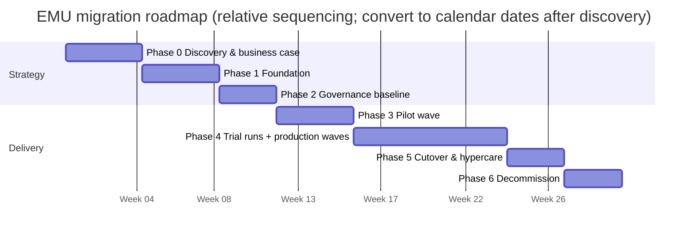

# Migration strategy and planning for GitHub Enterprise Managed Users

Purpose: define the end-to-end program structure, discovery work, sequencing, governance, and decision framework required to migrate from GitHub.com personal-account organizations to a new GitHub Enterprise Managed Users (EMU) enterprise with controlled risk.

> Last verified: 2026-10-15 against GitHub Docs

## Table of contents

- [How to use this document](#how-to-use-this-document)
- [Guiding principles](#guiding-principles)
- [Program governance](#program-governance)
- [Discovery and inventory](#discovery-and-inventory)
- [Identity mapping and account readiness](#identity-mapping-and-account-readiness)
- [Target organization structure and naming conventions](#target-organization-structure-and-naming-conventions)
- [Migration approach decisions](#migration-approach-decisions)
- [Phased roadmap](#phased-roadmap)
- [Timeline estimation guidance](#timeline-estimation-guidance)
- [Risk register and top risks](#risk-register-and-top-risks)
- [Communication plan outline](#communication-plan-outline)
- [Success metrics and KPIs](#success-metrics-and-kpis)
- [Planning checklist](#planning-checklist)
- [Related documents](#related-documents)

## How to use this document

This document is the planning spine for the full migration program.
Use it with [../README.md](../README.md), [01-why-migrate-to-emu.md](01-why-migrate-to-emu.md), [02-emu-fundamentals-and-decision-guide.md](02-emu-fundamentals-and-decision-guide.md), [04-identity-and-access.md](04-identity-and-access.md), [05-governance-security-compliance.md](05-governance-security-compliance.md), [06-technical-migration-guide.md](06-technical-migration-guide.md), [07-post-migration-and-change-management.md](07-post-migration-and-change-management.md), [08-pitfalls-and-mitigations.md](08-pitfalls-and-mitigations.md), [09-references-and-research-notes.md](09-references-and-research-notes.md), and [../checklists/migration-checklist.md](../checklists/migration-checklist.md).
GitHub Docs state that EMU requires a **new** enterprise account and that an existing enterprise using personal accounts cannot be converted in place.
That single fact makes this a migration program, not a feature toggle.

> **Note**
> GitHub Docs also state that EMU is not the best solution for every customer.
> Confirm operating constraints before you fund the program.

## Guiding principles

1. **Identity first:** EMU depends on IdP-managed lifecycle, authentication, usernames, profile data, org membership, and repo access.
2. **Design for a new destination:** plan a clean target enterprise, org, and team model instead of reproducing accidental source sprawl.
3. **Prefer supported patterns:** use one supported partner IdP for auth and provisioning when possible.
4. **Separate stages:** keep discovery, pilot, and production waves distinct.
5. **Trial before production:** GitHub strongly recommends trial runs, ideally in `-sandbox` orgs.
6. **Freeze during production migration:** GEI has no delta migration; changes during migration are lost.
7. **Prioritize by complexity:** wave design should emphasize PR/issue volume, integrations, rulesets, and repo size.
8. **Plan for follow-up work:** many important items are not migrated and must be rebuilt.
9. **Use internal visibility intentionally:** EMU org repos can be `private` or `internal` only.
10. **Protect names early:** if you want to reuse source names, plan source renames rather than deletion.
11. **Preserve attribution:** email alignment, mannequin reclaim, and team recreation affect continuity.
12. **Treat change management as a workstream:** onboarding, comms, and hypercare are delivery-critical.

> **Warning**
> Managed users cannot create public content or collaborate outside the enterprise.
> Developers who need outside collaboration should keep a separate personal account.

## Program governance

### Steering committee

The steering committee should own scope, funding, risk acceptance, and go/no-go decisions.
Recommended membership: executive sponsor, TPM/migration lead, enterprise owner sponsor, identity lead, platform lead, security/compliance lead, legal/procurement representative, change-management/DevEx lead, and engineering leaders from pilot and production waves.

### Core workstreams

| Workstream                     | Primary outcome                                            | Typical owners                          | Key decisions                                             |
| ------------------------------ | ---------------------------------------------------------- | --------------------------------------- | --------------------------------------------------------- |
| Identity                       | Working EMU auth, provisioning, team sync, account mapping | IAM, IdP admins, enterprise owners      | IdP choice, auth protocol, SCIM design, email alignment   |
| Platform / technical migration | Repeatable repo/org migration factory                      | Platform engineering, org owners        | Org vs repo migration, wave batches, sandbox approach     |
| Security and compliance        | Baseline controls and post-migration hardening             | Security, compliance, enterprise owners | Rulesets, GHAS posture, IP allow lists                    |
| Developer experience / change  | Developer readiness and hypercare                          | DevEx, enablement, service desk         | Training, FAQ, comms, support model                       |
| Legal / procurement            | Contractual and records readiness                          | Legal, procurement, privacy             | Enterprise procurement, retention/legal hold confirmation |

### Governance cadence

| Cadence                     | Audience                           | Purpose                      | Minimum output                     |
| --------------------------- | ---------------------------------- | ---------------------------- | ---------------------------------- |
| Weekly program review       | Workstream leads                   | Delivery status and blockers | RAID updates                       |
| Biweekly steering committee | Steering members                   | Decisions and escalations    | Decision log and actions           |
| Pilot readiness review      | Pilot sponsors + workstreams       | Approve pilot entry          | Signed readiness checklist         |
| Wave go/no-go               | Steering + affected org owners     | Approve production wave      | Go/no-go decision                  |
| Hypercare review            | Support, DevEx, platform           | Triage post-cutover issues   | Incident and adoption report       |
| Quarterly governance review | Enterprise owners + control owners | Continuous improvement       | Policy and operating model updates |

### Decision rights

| Decision                    | Accountable role     | Consulted roles                                            |
| --------------------------- | -------------------- | ---------------------------------------------------------- |
| Confirm EMU business case   | Executive sponsor    | Security, IAM, engineering leadership                      |
| Approve IdP and auth design | Identity lead        | Security, enterprise owners, GitHub account team if needed |
| Approve target org model    | Platform lead        | Identity, security, org owners                             |
| Approve wave plan           | TPM / migration lead | Workstream leads, steering committee                       |
| Approve final cutover       | Steering committee   | All workstreams                                            |

### RACI

Roles: **SC** = steering committee, **TPM** = migration lead, **ID** = identity lead, **PLAT** = platform lead, **SEC** = security lead, **DX** = developer-experience lead, **LEG** = legal/procurement lead, **OWN** = org owners.

| Activity                        | SC  | TPM | ID  | PLAT | SEC | DX  | LEG | OWN |
| ------------------------------- | --- | --- | --- | ---- | --- | --- | --- | --- |
| Build business case             | A   | R   | C   | C    | C   | C   | C   | C   |
| Select enterprise type          | A   | R   | C   | C    | C   | I   | C   | C   |
| Configure IdP auth and SCIM     | I   | C   | A/R | C    | C   | I   | I   | C   |
| Define org naming and structure | C   | R   | C   | A/R  | C   | C   | I   | C   |
| Inventory orgs and repos        | I   | A   | C   | R    | C   | I   | I   | R   |
| Score waves and batching        | I   | A/R | C   | R    | C   | C   | I   | C   |
| Run trial migrations            | I   | A   | I   | R    | C   | C   | I   | R   |
| Approve production freeze       | A   | R   | I   | C    | C   | C   | I   | R   |
| Execute production migration    | I   | A   | C   | R    | C   | C   | I   | R   |
| Re-enable integrations          | I   | C   | C   | A/R  | C   | I   | I   | R   |
| Developer re-onboarding         | I   | C   | C   | C    | I   | A/R | I   | R   |
| Decommission legacy orgs        | A   | R   | C   | C    | C   | C   | A/R | R   |

## Discovery and inventory

Discovery quality determines the realism of the wave plan.
Inventory should be repeatable, versioned, and refreshed before pilot and before each production wave.

### What to inventory

| Domain                     | What to capture                                                                                | Why it matters                                                         |
| -------------------------- | ---------------------------------------------------------------------------------------------- | ---------------------------------------------------------------------- |
| Organizations              | Source org names, owners, visibility policies, default branch naming, rulesets, IP allow lists | Drives destination topology and prerequisites                          |
| Repositories               | Repo name, owner org, visibility, archive state, default branch, size signals                  | Core migration scope                                                   |
| Pull requests and issues   | Counts per repo, open vs closed, high-activity repos                                           | GitHub Docs say migration timing depends mostly on PR and issue counts |
| Users                      | Org owners, members, outside collaborators, service users                                      | Supports account mapping and access rebuild                            |
| Teams                      | Team names, repo access, CODEOWNERS references, nested structure                               | Team membership is not migrated; synced-team constraints apply         |
| GitHub Apps and OAuth apps | Installed apps, permissions, owning teams, callback URLs                                       | Installations are not migrated                                         |
| Webhooks                   | Repo/org hooks, destinations, events, secrets owners                                           | Hooks migrate disabled and without webhook secrets                     |
| GitHub Actions             | Secrets, variables, environments, self-hosted/larger runners, workflows                        | Most operational Actions config is not migrated                        |
| Git LFS                    | Repos using LFS and object volume                                                              | LFS objects are not migrated                                           |
| Packages                   | Package registries, owners, consumers                                                          | Packages are not migrated                                              |
| Projects                   | Project usage and owners                                                                       | Projects (new experience) are not migrated                             |
| Discussions                | Repo discussion usage and critical threads                                                     | Repo-level discussions are not migrated                                |
| Rulesets and protections   | Org/repo rulesets, branch protections, bypass rules                                            | Rulesets can block migration; some protections are not migrated        |
| Forks                      | Fork network relationships and active contributors                                             | Fork relationships are not migrated                                    |
| Integrations / CI-CD       | External CI, deployment tooling, chatops, ticketing, bots                                      | Repointing often dominates cutover effort                              |
| Credentials                | PAT usage, SSH keys, deploy keys, service accounts                                             | PATs/SSH keys are not migrated; service account redesign may be needed |

### Discovery tools and sources

| Tool / source              | Use                                                                | Notes                                                     |
| -------------------------- | ------------------------------------------------------------------ | --------------------------------------------------------- |
| `gh gei` scripts and logs  | Migration planning and execution                                   | Keep the extension current; docs say it is updated weekly |
| `gh-repo-stats`            | Estate-level counts for repos, PRs, issues, users, projects/wikis  | Third-party and unsupported by GitHub Support             |
| `git-sizer`                | Detect large repo structures and history shape                     | Useful for monorepos and outliers                         |
| GitHub audit log           | Ownership, control changes, access patterns                        | Audit logs themselves are not migrated                    |
| GitHub REST / GraphQL APIs | Structured extraction for repos, teams, hooks, apps, rules, counts | Verify endpoint differences for GHE.com                   |
| Interviews and workshops   | Hidden integrations, legal constraints, support contacts           | Essential for critical repos                              |

> **Note**
> For GHE.com, API endpoints, IP ranges, and SSH fingerprints differ from GitHub.com.
> Validate every automation endpoint before trial runs if data residency is in scope.

### Sample inventory table schema

Use one row per repository as the primary inventory grain, with child tables for integrations and identities.

| Column                  | Example                                      | Notes                                       |
| ----------------------- | -------------------------------------------- | ------------------------------------------- |
| `source_org`            | `platform-eng`                               | Current GitHub.com org                      |
| `source_repo`           | `service-catalog`                            | Repository name                             |
| `destination_org`       | `platform-eng-sandbox`                       | Sandbox or production destination           |
| `migration_mode`        | `repo` or `org`                              | GEI path                                    |
| `visibility_target`     | `private` or `internal`                      | EMU destinations cannot be public           |
| `default_branch`        | `main`                                       | Validate post-migration                     |
| `repo_size_signal`      | `standard` / `large` / `monorepo`            | Derived from `git-sizer` and local analysis |
| `pr_count`              | `1234`                                       | Primary throughput input                    |
| `issue_count`           | `847`                                        | Primary throughput input                    |
| `open_pr_count`         | `42`                                         | Freeze coordination                         |
| `open_issue_count`      | `119`                                        | Stakeholder planning                        |
| `uses_lfs`              | `yes/no`                                     | LFS follow-up required                      |
| `uses_actions`          | `yes/no`                                     | Secrets/runners follow-up required          |
| `uses_packages`         | `yes/no`                                     | Packages are not migrated                   |
| `uses_discussions`      | `yes/no`                                     | Discussions are not migrated                |
| `has_repo_webhooks`     | `yes/no`                                     | Hooks migrate disabled                      |
| `has_github_apps`       | `yes/no`                                     | Reinstall required                          |
| `has_rulesets`          | `yes/no`                                     | Ruleset bypass may be needed                |
| `outside_collaborators` | `count`                                      | EMU collaboration implications              |
| `owner_contact`         | `team-alias@example.com`                     | Business and technical owner                |
| `wave`                  | `pilot`, `wave-1`, `wave-2`                  | Delivery planning                           |
| `status`                | `discovered`, `trialed`, `ready`, `migrated` | Tracking state                              |

## Identity mapping and account readiness

Identity mapping is one of the few planning activities that can prevent both access failure and lost attribution.

### Facts that directly affect planning

- The IdP controls usernames, profile data, email, membership, and repo access in EMU.
- The IdP can provide only **one** email to GitHub.
- Changing email in the IdP can unlink contribution history tied to the old email.
- Git commits are attributed by commit email, not mannequins.
- Username collisions can block provisioning; GitHub Docs state only the first user is created when a conflict exists within the same enterprise.

### Recommended user-mapping CSV or table

| Column                       | Description                                                |
| ---------------------------- | ---------------------------------------------------------- |
| `source_github_username`     | Current personal-account login                             |
| `source_display_name`        | Human-readable validation field                            |
| `source_primary_email`       | Email most commonly seen in commits                        |
| `idp_username`               | Username/UPN used by the IdP                               |
| `expected_emu_username`      | Expected GitHub managed username after shortcode suffixing |
| `email_to_publish_to_github` | The single IdP email that GitHub will send                 |
| `target_role`                | `member`, `owner`, or `guest collaborator`                 |
| `target_orgs`                | Destination org list                                       |
| `target_teams`               | Destination team list                                      |
| `mannequin_reclaim_needed`   | `yes/no`                                                   |
| `open_source_dual_account`   | `yes/no`                                                   |
| `status`                     | `draft`, `validated`, `ready`, `provisioned`               |

### Email alignment and readiness checks

- Compare dominant commit emails against the email the IdP will publish.
- Flag people with multiple historical commit emails.
- Flag contractors and outside collaborators who cannot become managed users.
- Validate naming collisions after normalization and shortcode suffixing.
- Validate total username length, especially if GHE.com is under consideration because verified facts say the username limit drops to 30 characters there.

### IdP design notes

- Entra ID supports SAML, OIDC, and SCIM; verified facts recommend OIDC for Entra ID.
- Okta supports SAML and SCIM, but not OIDC for EMU in the verified facts.
- PingFederate supports SAML and SCIM, but not OIDC in the verified facts.
- Mixing Okta and Entra ID for SSO and SCIM is explicitly unsupported.
- SCIM provisioning through the REST API is not supported for enterprises enabled for OIDC.
  Anything outside those patterns should be marked **verify with GitHub Docs/Support**.

## Target organization structure and naming conventions

Destination design should make EMU easier to operate than the source environment.

### Design principles

- Use a clear enterprise-wide org taxonomy.
- Reserve `internal` repositories for shared code, templates, and InnerSource scenarios.
- Separate highly restricted or regulated assets when policy requires it.
- Decide whether enterprise teams are useful for broader reuse.
- Create destination `-sandbox` orgs for trial runs and rehearsal.

### Naming conventions

| Object                | Recommendation                                                   | Rationale                                           |
| --------------------- | ---------------------------------------------------------------- | --------------------------------------------------- |
| Enterprise shortcode  | Choose carefully and keep it short                               | Docs say shortcode cannot be changed after creation |
| Managed usernames     | Preserve recognizable source identity before `_SHORTCODE` suffix | Reduces retraining burden                           |
| Sandbox orgs          | Add `-sandbox` suffix                                            | Makes non-production destinations obvious           |
| Production orgs       | Keep stable business-aligned names                               | Minimizes remote and documentation churn            |
| Shared internal repos | Use clear platform conventions                                   | Helps developers recognize enterprise-wide assets   |
| Service repos         | Standardize repo prefixes or topics                              | Simplifies operational ownership                    |
| Enterprise teams      | Use durable capability-based names                               | Better fit for IdP group sync                       |

### Team sync constraints that affect design

- Each synced team connects to one IdP group.
- The same group can feed multiple teams.
- Connected teams cannot be parent or child teams.
- Existing teams must have manual members removed before enabling IdP-managed sync.
- Repo access for teams remains managed on GitHub even when membership is IdP-managed.

## Migration approach decisions

### Org migration vs repo migration

| Decision area          | Org migration                                                    | Repo migration                                         |
| ---------------------- | ---------------------------------------------------------------- | ------------------------------------------------------ |
| Scope                  | Creates a **new** destination org and migrates all repos at once | Moves selected repos individually                      |
| Best fit               | Source org maps 1:1 to target org and all repos move together    | Need batching, filtering, or destination consolidation |
| Scale note             | Up to 5,000 repos per org migration per verified facts           | Up to 5 concurrent repo migrations per verified facts  |
| Selective inclusion    | No batching or skip within the org migration                     | Fine-grained selection and sequencing                  |
| Team objects           | Teams and repo access migrate, but team membership does not      | Teams generally need recreation or reconnection        |
| Operational complexity | Simpler if topology is already correct                           | Better when estate needs re-shaping                    |

### Batching strategy

GitHub Docs identify these practical grouping models: by organization (simplest 1:1), by team (recommended over business-division grouping when not using org batches), by business division, or by destination org when consolidating multiple sources.
Multiple batches can run simultaneously, and generated scripts can be split into several scripts.

### Wave criteria

Build waves from assets with similar business owners, support teams, integration sets, Actions runner patterns, ruleset profiles, collaboration models, and PR/issue volume.

### Scoring / prioritization matrix

Use a simple weighted score and adjust local weights as needed.

| Criterion                                                                                                                                                                                                             | Low complexity | Medium complexity | High complexity       |
| --------------------------------------------------------------------------------------------------------------------------------------------------------------------------------------------------------------------- | -------------- | ----------------- | --------------------- |
| PR count                                                                                                                                                                                                              | Few PRs        | Moderate PRs      | Many PRs              |
| Issue count                                                                                                                                                                                                           | Few issues     | Moderate issues   | Many issues           |
| Repo size / history                                                                                                                                                                                                   | Standard       | Large             | Very large / monorepo |
| Git LFS usage                                                                                                                                                                                                         | None           | Limited           | Heavy                 |
| Actions dependency                                                                                                                                                                                                    | Minimal        | Moderate          | Extensive             |
| App / webhook count                                                                                                                                                                                                   | Few            | Several           | Many / critical       |
| Rulesets / protections                                                                                                                                                                                                | Simple         | Mixed             | Complex or strict     |
| Outside-collaborator impact                                                                                                                                                                                           | None           | Some              | High                  |
| Open-source dual-account impact                                                                                                                                                                                       | None           | Some              | High                  |
| Business criticality                                                                                                                                                                                                  | Low            | Medium            | High                  |
| Suggested use: start the pilot with low-to-medium complexity assets; keep the first production wave free of the largest monorepos unless the pilot proved the pattern; treat high PR/issue repos as schedule drivers. |

### Freeze windows and trial runs

Because GEI has no delta migration, define a code freeze for each production batch, freeze PR merges/direct pushes before final migration, and pause automations that would create source churn.
GitHub strongly recommends trial runs close to production; use `-sandbox` orgs to answer whether the migration succeeds, whether the result is workable, and how long it takes.

## Phased roadmap

### Relative roadmap overview

> **Note**
> The chart is relative in purpose.
> Replace the placeholder anchor with your approved project start after pilot throughput is known.

### Phase-by-phase plan

| Phase                                       | Objectives                                                        | Key activities                                                                                                                                                                        | Deliverables                                                                                   | Exit criteria                                                                                                                |
| ------------------------------------------- | ----------------------------------------------------------------- | ------------------------------------------------------------------------------------------------------------------------------------------------------------------------------------- | ---------------------------------------------------------------------------------------------- | ---------------------------------------------------------------------------------------------------------------------------- |
| **0. Discovery & business case**            | Confirm EMU fit, scope, and sponsorship                           | Review EMU constraints; decide whether data residency is required; identify critical repos/orgs; confirm open-source participation needs; define success criteria and non-goals       | Approved business case, program charter, initial inventory, stakeholder map, initial risk list | Sponsor approves the move; major constraints/exclusions are documented; funding and staffing are confirmed                   |
| **1. Foundation: new EMU enterprise + IdP** | Stand up the destination enterprise and prove access              | Create the new enterprise; configure `shortcode_admin`; create the setup PAT with `scim:enterprise`; configure SAML or OIDC; configure SCIM; validate provisioning and deprovisioning | Working enterprise, working auth + SCIM, break-glass admin procedure, validated owner sign-in  | Enterprise owners can administer the platform; pilot users can authenticate; SCIM lifecycle behavior is validated            |
| **2. Governance baseline**                  | Establish the minimum viable control set for pilot and production | Define org/team design; plan team-to-group sync; review rulesets and branch protections; define GHAS, IP allow list, and app governance baselines; confirm service-account strategy   | Target org/team design, baseline controls, ruleset bypass plan, draft operating model          | Governance is approved for pilot; migration-blocking controls are handled; workstream owners agree on post-cutover ownership |
| **3. Pilot wave**                           | Prove the end-to-end pattern on low-to-medium complexity assets   | Create sandbox orgs; refresh discovery; generate/test GEI scripts; rebuild non-migrated items; run validation, mannequin reclaim, and re-onboarding; capture defects and duration     | Pilot records, updated runbooks, measured throughput data, confirmed training/support content  | Pilot assets are workable; support paths are proven; steering approves production-wave entry                                 |
| **4. Trial runs + production waves**        | Operate a reliable migration factory                              | Run final trial runs near production; freeze source activity; execute org/repo migrations; track warnings and exceptions; rebuild integrations and access; update dashboards          | Completed production waves, status reports, knowledge-base updates, exception log              | Wave acceptance criteria are met; residual issues are within tolerance; remaining backlog is reprioritized using real data   |
| **5. Cutover & hypercare**                  | Stabilize the destination and protect productivity                | Execute the cutover runbook; validate repos, orgs, teams, apps, and CI/CD; re-enable hooks and apps; run daily triage and office hours                                                | Hypercare dashboard, issue log, final wave sign-off, updated developer docs                    | Critical defects are resolved or accepted; support demand normalizes; ownership transitions to steady state                  |
| **6. Decommission**                         | Retire or lock legacy source environments safely                  | Remove or reduce legacy memberships; lock/archive old orgs; rename source orgs if names must be reused; confirm retention/legal-hold requirements; preserve required records          | Decommission record, name-reuse completion, final audit package, lessons learned               | Legacy environments are no longer used for active engineering; retention/legal owners sign off; closure report is approved   |

## Timeline estimation guidance

GitHub Docs state that migration timing depends **mostly on the number of pull requests and issues**.
Use that as the primary planning signal.

### Estimation approach

1. Group repos into candidate waves.
2. Measure pilot and trial-run duration by repo class.
3. Estimate future waves using PR/issue-heavy repos as the dominant variable.
4. Adjust for secondary factors: monorepo size, releases that may require `--skip-releases`, LFS usage, Actions/runners rebuild effort, app/webhook repointing effort, and ruleset validation time.
5. Add explicit post-migration stabilization time for each wave.

### Estimation cautions

- A technically fast migration can still have a slow business cutover if many integrations need repointing.
- Code search re-indexing can take hours after migration.
- Repo size matters, but it should not be the sole planning signal.
- Detailed throughput assumptions should be marked **verify with your own pilot data**.

## Risk register and top risks

### Risk register template

| ID    | Risk                               | Trigger / condition                              | Likelihood | Impact | Owner         | Mitigation                                   | Contingency                                                                 | Status |
| ----- | ---------------------------------- | ------------------------------------------------ | ---------- | ------ | ------------- | -------------------------------------------- | --------------------------------------------------------------------------- | ------ |
| R-001 | Example: commit attribution breaks | IdP email does not match historical commit email | Medium     | High   | Identity lead | Validate email alignment before provisioning | Use mannequin reclaim for non-commit activity; correct future email mapping | Open   |

### Top risks to track from day one

| Risk                                                | Why it matters                                                                   | Mitigation                                                  |
| --------------------------------------------------- | -------------------------------------------------------------------------------- | ----------------------------------------------------------- |
| EMU chosen without validating operating constraints | Managed users cannot collaborate outside the enterprise or create public content | Confirm workflow fit in Phase 0                             |
| Unsupported or mixed IdP design                     | Can block provisioning or reduce supportability                                  | Use one supported partner IdP pattern where possible        |
| Email mismatch breaks contribution continuity       | EMU accepts only one IdP email; changing it can unlink old history               | Complete identity mapping and email validation before pilot |
| Production changes occur during migration           | GEI has no delta migration                                                       | Enforce freeze windows and communications                   |
| Rulesets block import                               | Verified facts note rulesets can cause migration failures                        | Test in sandbox and configure approved bypasses             |
| Teams exist but memberships do not                  | Team membership is not migrated in org migration                                 | Pre-build IdP group sync and validate target access         |
| Apps/webhooks are forgotten                         | Apps are not migrated; hooks arrive disabled                                     | Maintain app/hook inventory with named owners               |
| LFS content is omitted                              | LFS objects are not migrated                                                     | Plan explicit LFS push tasks                                |
| Branch protection drift                             | Several settings are not migrated                                                | Compare protections before and after                        |
| CAP blocks migration or automation                  | Entra CAP can block PAT/SSH flows and GEI                                        | Use an approved exempt service account where required       |
| Name reuse is mishandled                            | Source and destination names share namespaces                                    | Prefer rename strategy before decommission                  |
| Open-source contributors lose clarity               | Developers may need separate personal accounts                                   | Publish dual-account guidance early                         |

## Communication plan outline

Communication should be wave-based, role-based, and repetitive.

| Audience                 | Message theme                                                             | When                                                    | Channel                                   |
| ------------------------ | ------------------------------------------------------------------------- | ------------------------------------------------------- | ----------------------------------------- |
| Executives               | Why EMU, milestones, risk, decisions needed                               | Monthly and at go/no-go points                          | Steering deck                             |
| Org owners / maintainers | Scope, freeze dates, validation tasks, owner actions                      | Discovery, pilot, each wave                             | Working sessions + email/chat             |
| Developers               | What changes for login, usernames, remotes, credentials, open-source work | Before pilot, before wave, at cutover, during hypercare | Guides, office hours, chat, recorded demo |
| Security / compliance    | Control baseline, evidence, exceptions                                    | Design reviews and pre-cutover                          | Review meetings                           |
| IT / IdP admins          | Provisioning, groups, account recovery, service-account exceptions        | Phase 1 onward                                          | Working sessions                          |
| Support / service desk   | FAQ, triage routing, severity model                                       | Before pilot and before each wave                       | Enablement sessions                       |

### Minimum comms package per wave

- Wave scope and repo list
- Freeze start and end times
- Developer action checklist
- Support contacts and office hours
- Known limitations and workarounds
- Go-live confirmation and rollback posture

## Success metrics and KPIs

Use a mix of delivery, quality, adoption, and control metrics.

| KPI                          | What good looks like                                    |
| ---------------------------- | ------------------------------------------------------- |
| Pilot success rate           | Pilot repos/orgs complete and pass validation           |
| Wave predictability          | Actual duration stays near trial-run expectation        |
| Post-cutover defect volume   | Falls wave over wave as runbooks mature                 |
| Re-onboarding completion     | Users sign in and restore local access quickly          |
| Team sync coverage           | Target teams mapped to IdP groups where intended        |
| App/webhook restoration      | Critical integrations restored within agreed SLA        |
| Mannequin reclaim completion | High-value repos have reclaimed authorship where needed |
| Security baseline completion | GHAS, rules, and access controls restored as planned    |
| Legacy shutdown progress     | Old orgs locked or decommissioned on schedule           |

> **Note**
> Do not compare waves only by raw repo count.
> Verified facts indicate PR and issue counts are the stronger timing signal.

## Planning checklist

- [ ] Confirm EMU is the correct operating model.
- [ ] Decide whether GitHub.com or GHE.com is the target.
- [ ] Choose the enterprise shortcode carefully.
- [ ] Stand up the new enterprise and setup user.
- [ ] Configure authentication and SCIM.
- [ ] Build the identity mapping dataset.
- [ ] Inventory orgs, repos, apps, hooks, Actions, LFS, packages, projects, discussions, rulesets, forks, and credentials.
- [ ] Decide org migration vs repo migration per scope segment.
- [ ] Create sandbox orgs for trial runs.
- [ ] Score and prioritize waves.
- [ ] Define freeze windows and owner approvals.
- [ ] Publish cutover, support, and re-onboarding plans.
- [ ] Validate decommission and name reuse strategy.

## Related documents

- [../README.md](../README.md)
- [01-why-migrate-to-emu.md](01-why-migrate-to-emu.md)
- [02-emu-fundamentals-and-decision-guide.md](02-emu-fundamentals-and-decision-guide.md)
- [04-identity-and-access.md](04-identity-and-access.md)
- [05-governance-security-compliance.md](05-governance-security-compliance.md)
- [06-technical-migration-guide.md](06-technical-migration-guide.md)
- [07-post-migration-and-change-management.md](07-post-migration-and-change-management.md)
- [08-pitfalls-and-mitigations.md](08-pitfalls-and-mitigations.md)
- [09-references-and-research-notes.md](09-references-and-research-notes.md)
- [../checklists/migration-checklist.md](../checklists/migration-checklist.md)
