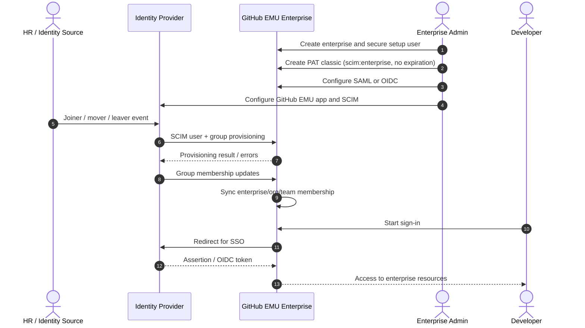

# Identity and access for GitHub Enterprise Managed Users

This guide defines the identity, provisioning, account design, and access-control decisions to make before you migrate from GitHub.com personal accounts to GitHub Enterprise Managed Users (EMU).

> Last verified: 2026-10-15 against GitHub Docs

## Table of contents

- [Where this guide fits](#where-this-guide-fits)
- [Core identity architecture decisions](#core-identity-architecture-decisions)
- [Identity provider selection](#identity-provider-selection)
- [SAML vs OIDC decision framework](#saml-vs-oidc-decision-framework)
- [Enterprise bootstrap sequence](#enterprise-bootstrap-sequence)
- [Provisioning and sign-in flow](#provisioning-and-sign-in-flow)
- [Username design](#username-design)
- [Email strategy](#email-strategy)
- [Role model](#role-model)
- [IdP groups to teams design](#idp-groups-to-teams-design)
- [Outside collaborators, contractors, and vendors](#outside-collaborators-contractors-and-vendors)
- [Service accounts and automation identities](#service-accounts-and-automation-identities)
- [Joiner-mover-leaver lifecycle](#joiner-mover-leaver-lifecycle)
- [Break-glass and setup user procedure](#break-glass-and-setup-user-procedure)
- [Mapping personal users to EMU users for mannequin reclaim](#mapping-personal-users-to-emu-users-for-mannequin-reclaim)
- [Developers with dual accounts](#developers-with-dual-accounts)
- [Troubleshooting SCIM and SSO](#troubleshooting-scim-and-sso)
- [Implementation checklist](#implementation-checklist)
- [Related reading](#related-reading)

## Where this guide fits

Use this guide with [../README.md](../README.md), [01-why-migrate-to-emu.md](01-why-migrate-to-emu.md), [02-emu-fundamentals-and-decision-guide.md](02-emu-fundamentals-and-decision-guide.md), [03-migration-strategy-and-planning.md](03-migration-strategy-and-planning.md), [06-technical-migration-guide.md](06-technical-migration-guide.md), [07-post-migration-and-change-management.md](07-post-migration-and-change-management.md), [08-pitfalls-and-mitigations.md](08-pitfalls-and-mitigations.md), [09-references-and-research-notes.md](09-references-and-research-notes.md), and [../checklists/migration-checklist.md](../checklists/migration-checklist.md).

## Core identity architecture decisions

Before you create the EMU enterprise, lock the following decisions:

1. **Hosting model**: GitHub.com or data-resident GHE.com.
2. **Identity provider**: ideally one supported partner IdP for both authentication and provisioning.
3. **Authentication method**: SAML or OIDC.
4. **Username source**: the IdP attribute that will become GitHub usernames after normalization.
5. **Primary email source**: the one IdP email sent to GitHub.
6. **Role model**: enterprise owners, billing managers, organization owners, members, guest collaborators, and repository collaborators.
7. **Group model**: which IdP groups drive organization membership, team membership, and license assignment.
8. **Automation model**: GitHub Apps, deploy keys, service accounts, and PAT governance.
9. **Break-glass model**: setup user storage, recovery codes, and emergency access procedure.

> **Warning**
> Shortcode choice on GitHub.com is permanent after the enterprise is created. Username design mistakes become visible everywhere because GitHub appends the shortcode to managed usernames.

## Identity provider selection

GitHub documents a "paved path" when you use a **single partner IdP for both authentication and provisioning**.

### Supported partner combinations

| IdP                    | SAML                  | OIDC                                | SCIM                  | Notes                                                                                          |
| ---------------------- | --------------------- | ----------------------------------- | --------------------- | ---------------------------------------------------------------------------------------------- |
| Microsoft Entra ID     | Supported             | Supported                           | Supported             | Only partner IdP that supports OIDC for EMU.                                                   |
| Okta                   | Supported             | Not supported                       | Supported             | SAML + SCIM supported.                                                                         |
| PingFederate           | Supported             | Not supported                       | Supported             | SAML + SCIM supported.                                                                         |
| Other / custom systems | Must support SAML 2.0 | Not documented as supported for EMU | Must support SCIM 2.0 | Use only if you accept reduced support; verify exact design with GitHub documentation/Support. |

### Preferred design

| Decision                                    | Recommendation                                                              | Why                                                                                    |
| ------------------------------------------- | --------------------------------------------------------------------------- | -------------------------------------------------------------------------------------- |
| Authentication + provisioning               | Use one partner IdP for both                                                | GitHub explicitly documents and supports this path.                                    |
| Entra tenants with one EMU enterprise       | Prefer OIDC                                                                 | GitHub recommends OIDC for Entra and it supports Conditional Access Policy (CAP).      |
| Entra tenants with multiple EMU enterprises | Use OIDC only for the first enterprise; use SAML for additional enterprises | GitHub documents that one Entra tenant can support only one OIDC integration with EMU. |
| Non-Entra IdP                               | Use SAML                                                                    | OIDC for EMU is documented only for Entra ID.                                          |

### Unsupported or high-risk combinations

| Combination                          | Status                      | Impact                                                                                           |
| ------------------------------------ | --------------------------- | ------------------------------------------------------------------------------------------------ |
| Okta for SSO + Entra for SCIM        | **Explicitly unsupported**  | GitHub's SCIM API returns provisioning errors.                                                   |
| Entra for SSO + Okta for SCIM        | **Explicitly unsupported**  | Same unsupported pairing in the reverse direction.                                               |
| Mixed or untested systems            | Not expressly supported     | GitHub Support may not be able to help with identity issues.                                     |
| Open SCIM REST integration with OIDC | Not supported               | GitHub documents that REST API SCIM provisioning is not supported when the enterprise uses OIDC. |
| OIDC with non-Entra IdP              | Not documented as supported | Treat as unsupported unless GitHub documentation/Support says otherwise.                         |

> **Note**
> GitHub does not test or validate gallery applications for Government Cloud environments such as Entra ID Government Cloud or Okta Government Cloud. If you operate there, verify the design with GitHub documentation/Support before committing to the architecture.

## SAML vs OIDC decision framework

### Summary decision table

| Topic                                    | SAML                                                         | OIDC                                                       |
| ---------------------------------------- | ------------------------------------------------------------ | ---------------------------------------------------------- |
| Supported EMU IdPs                       | Entra ID, Okta, PingFederate, and other SAML 2.0 systems     | Entra ID only                                              |
| IdP-initiated sign-in                    | Supported                                                    | Not supported                                              |
| Sign-in from GitHub login page           | Supported                                                    | Supported                                                  |
| Sign-in from enterprise/org profile page | Supported                                                    | Supported                                                  |
| Sign-in from IdP application portal      | Supported                                                    | Not supported                                              |
| Conditional Access Policy support        | No documented CAP integration                                | Supported for Entra ID                                     |
| Custom claims / attributes               | Verify with GitHub documentation/Support                     | Custom OIDC claims and attributes are not supported        |
| Best fit                                 | Broad IdP compatibility and multi-enterprise Entra use cases | Entra-first identity strategy and CAP-aware access control |

### When to choose OIDC

Choose OIDC when all of the following are true:

- Your IdP is **Microsoft Entra ID**.
- You want GitHub to validate access using Entra **Conditional Access Policy IP conditions**.
- You accept that **OIDC does not support IdP-initiated authentication**.
- You do not need custom OIDC claims.
- You are not trying to connect the same Entra tenant to multiple EMU enterprises with OIDC.

### When to choose SAML

Choose SAML when any of the following are true:

- You use **Okta** or **PingFederate**.
- You need **IdP-initiated authentication** from the IdP portal.
- You need more than one EMU enterprise from a single Entra tenant.
- You are using a custom SAML + SCIM design and have accepted the support trade-off.

### Entra OIDC + Conditional Access considerations

GitHub documents the following CAP behavior for EMU with OIDC:

- CAP support is available **only for Entra ID**.
- GitHub validates **CAP IP conditions** for:
  - web UI access,
  - IP changes during use,
  - PAT authentication,
  - SSH key authentication associated with a user account.
- GitHub **cannot enforce device compliance conditions**.
- MFA policies are enforced **at IdP sign-in time**.
- Deploy keys are **not** subject to CAP because they do not act on behalf of a user.
- GitHub Apps acting as the app or installation are allowed because they are not acting on behalf of a user.
- GitHub Apps or OAuth apps acting on behalf of a user will be evaluated using the app server's IP address.
- CAP protection for web sessions is documented as **public preview**.

### OIDC operational cautions

| Caution                                                        | Why it matters                                                                      |
| -------------------------------------------------------------- | ----------------------------------------------------------------------------------- |
| One Entra tenant supports only one OIDC EMU integration        | Blocks straightforward multi-enterprise reuse.                                      |
| OIDC has no IdP-initiated auth                                 | User education and bookmarks matter.                                                |
| Actions using PATs may be blocked by CAP                       | Prefer service accounts exempted from CAP, GitHub Apps, deploy keys, or cloud OIDC. |
| Codespaces and github.dev may be unavailable with IP-based CAP | Dynamic IPs may be blocked.                                                         |
| Enterprise Importer migrations can be blocked by CAP           | GitHub recommends a service account exempt from Entra CAP.                          |

### Migrating from SAML to OIDC

GitHub documents a supported migration path from **SAML to OIDC** when the current IdP is **Entra ID**.

#### Preconditions

- Current enterprise uses **SAML with Entra ID**.
- An Entra global administrator is available to consent to the OIDC app.
- You have the **setup user** credentials and **enterprise recovery codes**.
- You schedule downtime because users cannot access the enterprise during the migration.

#### Documented migration effects

- Migration can take **up to an hour**.
- During migration, users cannot access enterprise resources.
- Existing team-to-IdP-group connections are removed if you migrate to a new IdP or tenant.
- Managed users or groups that are not reprovisioned by the OIDC app will have **"(SAML)" appended** to display names.

#### Practical migration sequence

1. Disable provisioning in the old Entra SAML app.
2. If you use Entra Conditional Access network location policies and GitHub IP allow lists, disable the GitHub IP allow lists before migration.
3. Sign in as the setup user with a recovery code.
4. Start **Migrate to OpenID Connect single sign-on** in enterprise settings.
5. Consent to the GitHub Enterprise Managed User (OIDC) app in Entra as a global admin.
6. Download the new enterprise recovery codes.
7. Create a new **personal access token (classic)** with `scim:enterprise` and **no expiration**.
8. Configure SCIM for the new OIDC app.
9. Copy users and groups from the old app to the new OIDC app.
10. Test with one user, then start full provisioning.

> **Warning**
> Do not provision new users from Entra during the SAML-to-OIDC migration window.

## Enterprise bootstrap sequence

### Step-by-step bootstrap

1. **Create a new EMU enterprise account**.
   - On GitHub.com, you choose the enterprise shortcode.
   - On GHE.com, the shortcode is randomly generated and hidden.
2. **Record the hosting location**.
   - GitHub.com and GHE.com use similar setup flows, but different URLs and sometimes different integration values.
3. **Create and secure the setup user**.
   - GitHub sends an invitation email for the setup user.
   - The setup user is the first enterprise owner.
   - It is the **only** account in the enterprise that is **not** SCIM-provisioned.
   - Username format is `SHORTCODE_admin`.
4. **Use a private/incognito browser window** for the initial setup user configuration.
5. **Set the setup user password**.
6. **Enable 2FA for the setup user** and save the account recovery codes.
7. **Download enterprise recovery codes**.
8. **Store setup user credentials** in the company password manager.
9. **Create a PAT classic as the setup user**.
   - Scope: at least `scim:enterprise`
   - Expiration: **no expiration**
10. **Configure authentication**.
    - Entra: choose SAML or OIDC.
    - Okta/PingFederate/others: SAML.
11. **Configure SCIM provisioning**.
12. **Assign test users and groups in the IdP**.
13. **Validate sign-in, provisioning, username format, role mapping, and team sync**.
14. **Only then** start broad user assignment.

### Shortcode selection guidance

| Hosting model | Shortcode behavior                                      | Design implication                                                                        |
| ------------- | ------------------------------------------------------- | ----------------------------------------------------------------------------------------- |
| GitHub.com    | Customer chooses a 3-8 character alphanumeric shortcode | Pick something short, stable, and recognizable because it becomes part of every username. |
| GHE.com       | GitHub generates a hidden shortcode                     | Username length limit is lower because the hidden shortcode still exists.                 |

### Setup user operating notes

| Fact                                                       | Why it matters                                             |
| ---------------------------------------------------------- | ---------------------------------------------------------- |
| Setup user is the only non-SCIM account                    | It is your break-glass identity.                           |
| Recovery codes are required for some reconfiguration tasks | Store them with the same care as production admin secrets. |
| Password reset by email does not work for the setup user   | If needed, contact GitHub Support.                         |
| All future access to the setup user requires 2FA           | Test the stored procedure before go-live.                  |

## Provisioning and sign-in flow



## Username design

### Documented username rules

| Rule               | GitHub.com EMU                                    | GHE.com EMU                               |
| ------------------ | ------------------------------------------------- | ----------------------------------------- |
| Username source    | Normalized SCIM `userName` attribute              | Normalized SCIM `userName` attribute      |
| Suffix             | `_SHORTCODE` appended                             | Hidden shortcode still appended           |
| Total max length   | 39 characters including underscore + shortcode    | 30 characters because of hidden shortcode |
| Allowed characters | Alphanumeric and dashes                           | Alphanumeric and dashes                   |
| Case handling      | Casing is preserved                               | Casing is preserved                       |
| Invalid patterns   | Cannot start or end with `-`; cannot contain `--` | Same                                      |

### Normalization behavior

GitHub documents these rules:

1. Non-alphanumeric characters are normalized to `-`.
2. Usernames derived from email addresses use the characters **before** `@`.
3. Usernames derived from domain accounts use the characters **after** `\`.
4. If multiple users normalize to the same result, only the first user is provisioned.
5. A username conflict returns **409** during provisioning.
6. An overlength username returns **400** during provisioning.

### Examples from GitHub Docs

| Identifier on provider                                        | Normalized result on GitHub.com                              | Outcome                                          |
| ------------------------------------------------------------- | ------------------------------------------------------------ | ------------------------------------------------ |
| `The.Octocat`                                                 | `The-Octocat_SHORT-CODE`                                     | Created successfully                             |
| `!The.Octocat`                                                | `-The-Octocat_SHORT-CODE`                                    | Fails because it starts with a dash              |
| `The!!Octocat`                                                | `The--Octocat_SHORT-CODE`                                    | Fails because it contains consecutive dashes     |
| `The!Octocat`                                                 | `The-Octocat_SHORT-CODE`                                     | Fails if that normalized username already exists |
| `The.Octocat@example.com`                                     | `The-Octocat_SHORT-CODE`                                     | Same collision risk as above                     |
| `internal\The.Octocat`                                        | `The-Octocat_SHORT-CODE`                                     | Same collision risk as above                     |
| `mona.lisa.the.octocat.from.github.united.states@example.com` | `mona-lisa-the-octocat-from-github-united-states_SHORT-CODE` | Fails because it exceeds the limit               |

### Entra-specific collision risk

For Entra ID, GitHub documents that the normalized username is built from the UPN characters before `@` and excludes `#EXT#` for guest accounts. These example UPNs can collide:

- `bob@contoso.com`
- `bob@fabrikam.com`
- `bob#EXT#fabrikamcom@contoso.com`
- `bob_example#EXT#fabrikamcom@contoso.com`
- `bob_example.com#EXT#fabrikamcom@contoso.com`

### Recommended preparation for IdP data

| Preparation step                                          | Why                                                                                             |
| --------------------------------------------------------- | ----------------------------------------------------------------------------------------------- |
| Inventory current UPN / username values                   | Finds collisions early.                                                                         |
| Calculate normalized GitHub usernames before provisioning | Lets you catch 409 and 400 errors before cutover.                                               |
| Keep the shortcode as short as possible on GitHub.com     | Preserves username space.                                                                       |
| Avoid punctuation-heavy aliases                           | Reduces normalization surprises.                                                                |
| Add a uniqueness component if needed                      | Common pattern: employee ID or other stable suffix; verify exact expression with your IdP docs. |
| Freeze the mapping before bulk provisioning               | Prevents user confusion and unexpected renames.                                                 |

> **Note**
> GitHub documents that changing the `userName` attribute mapping updates existing managed usernames, but does not change anything else about the account, including activity history.

## Email strategy

### Documented facts

- The IdP can provide **only one email address** to a managed user account.
- Managed users **cannot change** their profile name or email address on GitHub.
- Changing the user's email in the IdP **unlinks** the user from contribution history associated with the old email address.

### Practical email strategy

| Recommendation                                              | Why                                                                         |
| ----------------------------------------------------------- | --------------------------------------------------------------------------- |
| Pick one durable corporate email per person                 | GitHub receives only one email from the IdP.                                |
| Keep commit email aligned with the managed account identity | Maximizes attribution continuity.                                           |
| Avoid changing the managed email after migration            | GitHub documents contribution history unlinking when the IdP email changes. |
| Clean up aliasing and rebrands before provisioning          | Prevents post-migration attribution surprises.                              |

### Commit-email alignment checklist

- Decide the primary corporate email that should back the EMU identity.
- Tell developers which commit email to use after migration.
- For signed commits, remember that signing keys are **not migrated** by GitHub Enterprise Importer and must be re-added later.
- If you intend to use an alternate commit email strategy, **verify with GitHub documentation/Support** how that will affect attribution for managed users.

## Role model

### Enterprise-level roles

| Role               | Documented ability summary                                                                 | Suggested use                                            |
| ------------------ | ------------------------------------------------------------------------------------------ | -------------------------------------------------------- |
| Enterprise owner   | Can manage all enterprise settings, members, policies, billing, and security settings      | Small central platform/security group only               |
| Billing manager    | Can manage enterprise billing settings only                                                | Finance / FinOps / procurement staff                     |
| App manager        | Can manage enterprise-owned GitHub App registrations                                       | Platform engineering team                                |
| Security manager   | Can view security results and manage security settings for the enterprise (public preview) | Central AppSec / DevSecOps                               |
| User               | Regular enterprise member with no enterprise admin access                                  | Default for staff developers                             |
| Guest collaborator | Limited access role available only with EMU                                                | Vendors and contractors with scoped needs                |
| Custom role        | Enterprise-defined permission bundle                                                       | Separation of duties when predefined roles are too broad |

### Organization and repository access roles

| Scope        | Role                    | What to remember                                                                                           |
| ------------ | ----------------------- | ---------------------------------------------------------------------------------------------------------- |
| Organization | Organization owner      | Needed for local org administration; enterprise owners do not automatically get org access.                |
| Organization | Member                  | Can access internal repositories across the enterprise if they are a regular user added to one org.        |
| Repository   | Repository collaborator | In EMU documentation, outside collaborator behavior generally maps to repository collaborator terminology. |
| Enterprise   | Guest collaborator      | Can be org member or repository collaborator, but does not get broad internal access.                      |

### Role design baseline

- Keep **enterprise owners** to a very small number.
- Use **billing managers** instead of owner rights for cost administration.
- Use **security managers** or custom roles for security operations when available and approved.
- Use **organization owners** only for teams that genuinely operate that organization.
- Prefer **guest collaborator** over full member for vendors and tightly scoped contractors.

## IdP groups to teams design

### What GitHub documents

- You can connect a GitHub team to **one** IdP group.
- The same IdP group can be assigned to **multiple** GitHub teams.
- Team sync automatically adds users to an organization when group membership requires it.
- If a group is disconnected from a team, GitHub removes users who got org membership only through that path.
- Teams connected to IdP groups **cannot** be parent teams or child teams.
- A synced team cannot use the **team maintainer** role.
- Repository access for teams is still configured **on GitHub**.

### Entra-specific constraints

GitHub documents these Entra rules:

- Only **security groups** are supported.
- **Nested groups** are not supported.
- **Microsoft 365 groups** are not supported.
- Entra does not support provisioning nested groups for this flow.

### Naming pattern guidance

Use naming that makes the purpose obvious in both the IdP and GitHub.

| Layer             | Example pattern           | Purpose                      |
| ----------------- | ------------------------- | ---------------------------- |
| Enterprise access | `gh-all-engineering`      | Broad access / license scope |
| Org membership    | `gh-org-platform-members` | Adds people to one org       |
| Team sync         | `gh-team-platform-sre`    | Drives a specific team       |
| Privileged admin  | `gh-org-platform-owners`  | Separate owner population    |
| Guest / vendor    | `gh-vendor-foo-repo-x`    | Narrow external scope        |

### Enterprise teams vs organization teams

| Team type                                      | Best use                                                                       | Limits / caveats                                                           |
| ---------------------------------------------- | ------------------------------------------------------------------------------ | -------------------------------------------------------------------------- |
| Enterprise team                                | Cross-org access, enterprise roles, Copilot license assignment, ruleset bypass | No CODEOWNER status, no nested teams, no team maintainers, no secret teams |
| Organization team                              | Org-scoped repository access and CODEOWNERS                                    | Scope limited to one organization                                          |
| GitHub documents these enterprise team limits: |

- Up to **2,500** enterprise teams per enterprise
- Up to **5,000** users per team
- Up to **1,000** organizations per team

### Suggested design pattern

1. Use **enterprise teams** for enterprise-wide roles, Copilot access, and cross-org administration.
2. Use **organization teams** for repository permissions and CODEOWNERS.
3. Keep the IdP as the source of truth for membership.
4. Keep GitHub as the source of truth for repository permission grants.

> **Warning**
> Before connecting an existing GitHub team to an IdP group, GitHub requires you to remove manually added members from the team first.

## Outside collaborators, contractors, and vendors

### Guest collaborators in EMU

GitHub documents that guest collaborators:

- are provisioned by the IdP like other managed users,
- can be added as organization members or repository collaborators,
- cannot access internal repositories except in organizations where they are added as members.
  This is the key difference from regular users, who gain automatic access to all internal repositories once they are added to one organization.

### Recommended contractor patterns

| Scenario                                                          | Recommended pattern                                                                                                   |
| ----------------------------------------------------------------- | --------------------------------------------------------------------------------------------------------------------- |
| Contractor needs normal day-to-day engineering access             | Provision as a regular EMU user through the IdP                                                                       |
| Contractor needs only narrow repository or org access             | Provision as a **guest collaborator** via the IdP                                                                     |
| Vendor needs access but cannot exist in your IdP                  | They cannot become an EMU user; use an alternate collaboration model and **verify with GitHub documentation/Support** |
| External partner must work in open source outside your enterprise | Keep that work on a separate personal account, not the managed account                                                |

### Policy implications

- Treat contractor onboarding as **identity onboarding**, not ad hoc repository invites.
- Use guest collaborator groups for vendors instead of making them full members.
- Avoid manual one-off permissions where an IdP-backed group can express the same rule.

## Service accounts and automation identities

### What the docs directly support

| Identity type             | What GitHub documents                                                                                                                                                            |
| ------------------------- | -------------------------------------------------------------------------------------------------------------------------------------------------------------------------------- |
| GitHub App                | Preferred for non-user automation in general practice; GitHub documents that app or installation calls are not evaluated against CAP because they do not act on behalf of a user |
| OAuth app                 | Supported by the platform, but user-context requests will be evaluated against CAP using the app server IP                                                                       |
| Deploy key                | Not subject to CAP because it is not a user identity                                                                                                                             |
| User PAT                  | Evaluated against CAP when associated with a user account                                                                                                                        |
| SSH key on a user account | Evaluated against CAP when associated with a user account                                                                                                                        |

### Recommended automation posture

| Use case                           | Recommended identity                                                                                       |
| ---------------------------------- | ---------------------------------------------------------------------------------------------------------- |
| CI/CD integration with GitHub APIs | GitHub App where possible                                                                                  |
| Repository deploy access           | Deploy key when repo-scoped access is sufficient                                                           |
| Cloud deployments from Actions     | GitHub Actions OIDC to the cloud provider                                                                  |
| Legacy user-context automation     | Dedicated service account with tightly governed PATs; if CAP is used, consider a documented exemption path |

### Managed service accounts

A common enterprise pattern is to provision dedicated automation identities through the IdP and treat them like service principals with owner-approved lifecycle controls.

> **Note**
> The exact support boundaries for "machine users as EMU users" should be **verified with GitHub documentation/Support** for your tenancy and control model.

### PAT governance baseline

- Use **PAT classic only where required**, such as GitHub Enterprise Importer.
- Prefer **GitHub Apps** or **fine-grained controls** where compatible with the use case.
- Enforce lifetime controls after migration, but exempt critical administrators or migration paths when GitHub documents that an exemption is necessary.
- Record owner, purpose, rotation date, and system dependency for every long-lived token.

### Actions OIDC to cloud

Prefer GitHub Actions OIDC federation to cloud providers over storing long-lived cloud secrets.
For GHE.com, GitHub documents that the Actions OIDC issuer differs from GitHub.com:

- GitHub.com issuer: `https://token.actions.githubusercontent.com`
- GHE.com issuer: `https://token.actions.SUBDOMAIN.ghe.com`

## Joiner-mover-leaver lifecycle

### Joiner

1. Person is created or activated in the IdP.
2. User is assigned to the GitHub EMU application.
3. SCIM provisions the managed account.
4. Group assignments provision org membership and team membership.
5. User authenticates through SSO.

### Mover

1. Update role, group membership, or both in the IdP.
2. SCIM updates the GitHub account and group-linked memberships.
3. If repository access is based on team membership, access changes follow the team sync.
4. If the person had manual org membership or manual permissions, those must be reviewed separately.

### Leaver

GitHub documents that when a user is unassigned from the IdP application or deactivated in the IdP:

- SCIM invalidates sessions,
- disables the account,
- keeps the account record,
- changes the username to a hash of the original username, with shortcode appended if applicable.
  If the user is later reassigned or reactivated, GitHub restores the account and the original username.

### Important removal nuance

GitHub documents:

- If a member was added to an organization **manually**, you must remove them **manually**.
- If a user became an org member through IdP groups, remove them from **all mapped IdP groups** for that organization.

### Lifecycle control table

| Lifecycle event | IdP action                      | GitHub result                               | Admin follow-up                                                  |
| --------------- | ------------------------------- | ------------------------------------------- | ---------------------------------------------------------------- |
| Joiner          | Assign EMU app + groups         | Account provisioned and added to enterprise | Validate username, email, orgs, teams                            |
| Mover           | Change groups / role attributes | Team and org membership reconciled          | Review exceptions and manual grants                              |
| Leaver          | Unassign app or deactivate user | Sessions invalidated, account disabled      | Remove any manual org membership or external system dependencies |
| Rehire          | Reassign app or reactivate user | Account reactivated and username restored   | Revalidate least privilege                                       |

## Break-glass and setup user procedure

### Why the setup user matters

The setup user is your emergency administration identity for:

- authentication reconfiguration,
- provisioning reconfiguration,
- IdP migration,
- use of enterprise recovery codes.

### Minimum operational procedure

1. Store the setup user username, password, 2FA method details, account recovery codes, and **enterprise recovery codes** in the company password vault.
2. Restrict access to a very small group of named administrators.
3. Test sign-in and recovery procedures before migration cutover.
4. Use a private browsing window for break-glass access.
5. Log every use of the setup user in your change-management process.

### If the IdP is unavailable

1. Access GitHub with the setup user.
2. Use an **enterprise recovery code** when prompted.
3. Perform the emergency change, such as disabling or reconfiguring authentication, or updating provisioning.
4. Rotate or replace stored secrets if the break-glass path was exercised in a real incident.

> **Warning**
> The setup user is also the account that appears as the actor for certain SCIM group audit events. Protect it like a production root account.

## Mapping personal users to EMU users for mannequin reclaim

After GitHub Enterprise Importer migrations, non-commit history is attributed to mannequins until reclaimed.

### What GitHub documents

- Only **existing organization members** can be targets for mannequin reclaim.
- Reclaim can be done individually or in bulk.
- For EMU organizations, you can add `--skip-invitation` to reclaim immediately.

### Recommended mapping process

1. Provision the destination EMU users first.
2. Ensure each target user is already a member of the destination organization.
3. Generate the mannequin CSV.
4. Add the destination EMU usernames to the CSV.
5. Reclaim in bulk.
6. Use `--skip-invitation` for EMU if immediate reclaim is desired.

### Example CLI flow

```shell
gh gei generate-mannequin-csv --github-target-org DESTINATION --output mannequins.csv
gh gei reclaim-mannequin --github-target-org DESTINATION --csv mannequins.csv --skip-invitation
```

### Mapping advice

| Source identity signal            | Destination mapping hint                                 |
| --------------------------------- | -------------------------------------------------------- |
| Personal GitHub username          | Use HR/IdP mapping workbook to find the new EMU username |
| Source email in migration records | Match to the corporate email used for the EMU account    |
| HR identifier                     | Best fallback when usernames changed materially          |

## Developers with dual accounts

GitHub documents that developers may need both:

- a managed account for enterprise work, and
- a personal account for open source or other non-enterprise work.

### Supported user experience guidance from GitHub Docs

| Surface                | Guidance                                                                                 |
| ---------------------- | ---------------------------------------------------------------------------------------- |
| Command line           | Configure Git for multiple accounts                                                      |
| Git Credential Manager | Turn off account filtering if SSO redirect is not enabled and users see repeated prompts |
| Web UI                 | Use GitHub account switching                                                             |

### Practical policy

- Use the **managed account** for enterprise work only.
- Use the **personal account** for public OSS and community participation.
- Train developers on separate SSH keys, Git identities, and browser sessions.
- Publish a short workstation setup standard during migration readiness.

## Troubleshooting SCIM and SSO

| Symptom                                                       | Likely cause                                                        | Fix                                                                                          |
| ------------------------------------------------------------- | ------------------------------------------------------------------- | -------------------------------------------------------------------------------------------- |
| SCIM provisioning returns `409`                               | Username conflict after normalization                               | Adjust the `userName` value or mapping in the IdP so the normalized value is unique          |
| SCIM provisioning returns `400`                               | Username exceeds GitHub length limit                                | Shorten the source value or mapping                                                          |
| User cannot sign in from IdP portal when using OIDC           | OIDC does not support IdP-initiated authentication                  | Start sign-in from GitHub instead                                                            |
| Provisioning fails in an Okta + Entra mixed design            | Explicitly unsupported combination                                  | Move to one supported partner IdP for both SSO and SCIM                                      |
| Team sync is missing expected members in Entra                | Nested groups or Microsoft 365 groups are in use                    | Use direct membership in Entra security groups                                               |
| Existing team cannot be connected to IdP group                | Team still has manual members, or team is nested                    | Remove manual members and remove parent/child relationships first                            |
| User lost access after group disconnect                       | Team sync removed org membership that existed only through the team | Re-add membership through the correct IdP group or explicit org membership path              |
| Automation breaks after enabling CAP                          | PAT, SSH, or app-on-behalf-of-user requests fail CAP evaluation     | Use GitHub Apps, deploy keys, OIDC-to-cloud, or exempt the approved service account from CAP |
| Codespaces or github.dev stop working with Entra CAP          | Dynamic IPs are blocked by CAP                                      | Re-evaluate CAP design for these services                                                    |
| Setup user password reset via normal email flow fails         | Setup user does not use the standard email reset flow               | Contact GitHub Support                                                                       |
| Recovery access fails during SAML-to-OIDC migration           | Wrong recovery code type                                            | Use an **enterprise** recovery code, not the user-account recovery code                      |
| SCIM works but OIDC enterprise is using open SCIM REST design | REST SCIM with OIDC is not supported                                | Move to the supported Entra OIDC provisioning application                                    |

## Implementation checklist

- [ ] Choose hosting model: GitHub.com or GHE.com
- [ ] Choose one supported IdP strategy
- [ ] Decide SAML vs OIDC
- [ ] Design the shortcode and username mapping
- [ ] Validate normalized usernames for uniqueness and length
- [ ] Decide the single corporate email per user
- [ ] Secure the setup user and store all recovery artifacts
- [ ] Create the `scim:enterprise` PAT classic with no expiration
- [ ] Configure authentication
- [ ] Configure SCIM
- [ ] Pilot with test users and groups
- [ ] Design team-sync groups and enterprise teams
- [ ] Define vendor/contractor access patterns
- [ ] Publish dual-account guidance for developers
- [ ] Prepare mannequin reclaim mapping

## Related reading

See [02-emu-fundamentals-and-decision-guide.md](02-emu-fundamentals-and-decision-guide.md), [03-migration-strategy-and-planning.md](03-migration-strategy-and-planning.md), [06-technical-migration-guide.md](06-technical-migration-guide.md), [07-post-migration-and-change-management.md](07-post-migration-and-change-management.md), [08-pitfalls-and-mitigations.md](08-pitfalls-and-mitigations.md), [09-references-and-research-notes.md](09-references-and-research-notes.md), and [../checklists/migration-checklist.md](../checklists/migration-checklist.md).
