# 06. Technical migration guide

This runbook is the step-by-step technical procedure for moving repositories or whole organizations from GitHub.com organizations backed by personal accounts into a new Enterprise Managed Users (EMU) enterprise on GitHub.com or GitHub Enterprise Cloud with data residency (GHE.com). Use it with the planning, identity, governance, and change-management documents linked throughout this guide.

> Last verified: 2026-10-15 against GitHub Docs

## Table of contents

- [Audience, scope, and assumptions](#audience-scope-and-assumptions)
- [Related documents](#related-documents)
- [Migration architecture and flow](#migration-architecture-and-flow)
- [Choose the right migration pattern](#choose-the-right-migration-pattern)
- [What GitHub Enterprise Importer migrates](#what-github-enterprise-importer-migrates)
  - [Repository migration scope](#repository-migration-scope)
  - [Additional scope for organization migrations](#additional-scope-for-organization-migrations)
  - [Not migrated or only partially migrated](#not-migrated-or-only-partially-migrated)
  - [Branch protection gaps to document before cutover](#branch-protection-gaps-to-document-before-cutover)
- [Prerequisites](#prerequisites)
- [Roles, permissions, and the migrator role](#roles-permissions-and-the-migrator-role)
- [PAT creation, scopes, and SSO authorization](#pat-creation-scopes-and-sso-authorization)
- [IP allow lists and Conditional Access](#ip-allow-lists-and-conditional-access)
- [Install and update the CLI tooling](#install-and-update-the-cli-tooling)
- [Environment variables](#environment-variables)
- [Pre-migration repository hygiene](#pre-migration-repository-hygiene)
- [Destination preparation](#destination-preparation)
- [Trial run procedure](#trial-run-procedure)
- [Validation ideas and sample scripts](#validation-ideas-and-sample-scripts)
- [Production run procedure](#production-run-procedure)
  - [Repository migration workflow](#repository-migration-workflow)
  - [Organization migration workflow](#organization-migration-workflow)
  - [GHE.com command variants](#ghecom-command-variants)
- [Log review](#log-review)
- [Post-migration follow-ups](#post-migration-follow-ups)
- [Migrating what GEI does not migrate](#migrating-what-gei-does-not-migrate)
- [CI/CD and integration repointing](#cicd-and-integration-repointing)
- [Developer cutover tasks](#developer-cutover-tasks)
- [Rollback strategy](#rollback-strategy)
- [Troubleshooting](#troubleshooting)
- [Automation appendix](#automation-appendix)

## Audience, scope, and assumptions

- **Source**: GitHub.com organizations that currently use personal accounts.
- **Destination**: a **new** EMU enterprise on GitHub.com or GHE.com.
- **Tooling**: GitHub Enterprise Importer (GEI) through the GitHub CLI extension `gh-gei`.
- **Identity model**: IdP-managed authentication and SCIM provisioning.
- **Safety rule**: use only documented GEI commands and options verified in GitHub Docs. If you need a variation that is not shown here, run `gh gei <command> --help` and verify against [GitHub documentation and research notes](09-references-and-research-notes.md).

> **Warning**
> Existing enterprise accounts that use personal accounts cannot be converted in place to EMU. Adopting EMU requires migration to a **new enterprise account**. Choose the enterprise type before creating the enterprise.

## Related documents

- [Repository overview](../README.md)
- [Why migrate to EMU](01-why-migrate-to-emu.md)
- [EMU fundamentals and decision guide](02-emu-fundamentals-and-decision-guide.md)
- [Migration strategy and planning](03-migration-strategy-and-planning.md)
- [Identity and access](04-identity-and-access.md)
- [Governance, security, and compliance](05-governance-security-compliance.md)
- [Post-migration and change management](07-post-migration-and-change-management.md)
- [Pitfalls and mitigations](08-pitfalls-and-mitigations.md)
- [References and research notes](09-references-and-research-notes.md)
- [Migration checklist](../checklists/migration-checklist.md)

## Migration architecture and flow

```mermaid
flowchart LR
    A[Source GitHub.com orgs<br/>personal accounts] --> B[Inventory and hygiene<br/>rulesets branch protections LFS sizes]
    B --> C[Create new EMU enterprise<br/>GitHub.com or GHE.com]
    C --> D[Configure IdP authn<br/>SAML or OIDC where supported]
    C --> E[Configure SCIM provisioning<br/>setup user classic PAT]
    D --> F[Create destination orgs teams<br/>runner groups GHAS policies]
    E --> F
    F --> G[Create migration service accounts<br/>classic PATs SSO authorization]
    G --> H[Trial migration to sandbox orgs]
    H --> I[Validate counts warnings and access]
    I --> J[Production migration<br/>repo or org waves]
    J --> K[Download logs and fix warnings]
    K --> L[Manual follow-ups<br/>LFS secrets apps webhooks teams]
    L --> M[Mannequin reclaim and cutover]
    M --> N[Hypercare and source retirement]
```



### Architecture notes

- The **destination** is authoritative for all GEI orchestration. Repository and organization migration APIs run against the destination enterprise.
- For **GHE.com**, the API host changes to `https://api.SUBDOMAIN.ghe.com`.
- GEI performs a **copy migration**. The source is not deleted.
- GEI has **no delta migration** mode. Any source changes made after migration starts are lost from the migrated copy.
- Repository migrations support **up to five concurrent migrations**.
- Organization migrations create a **new destination organization** and move **all repositories at once**; they cannot be batched or skipped within the organization migration itself.

## Choose the right migration pattern

| Pattern                        | Best for                                                                                                         | Key limits                                                                          | Recommended use                                       |
| ------------------------------ | ---------------------------------------------------------------------------------------------------------------- | ----------------------------------------------------------------------------------- | ----------------------------------------------------- |
| Repository migration           | Selective waves, team-based cutovers, organizations with more than 5,000 repositories, or when you need batching | Up to 5 concurrent repo migrations                                                  | Default for most staged programs                      |
| Organization migration         | Clean 1:1 move of a whole source org into a new destination org                                                  | All repos move together; no skip/batch; up to 5,000 repositories                    | Use when the source org is ready for one-shot cutover |
| Trial migration to sandbox org | Dry run, timing estimate, runbook proving                                                                        | Must be repeated as a fresh migration for production because there is no delta mode | Always do this before production                      |

> **Note**
> Timing depends mostly on the number of pull requests and issues. Use trial runs to learn whether the migrated result is workable and how long the final run will take.

## What GitHub Enterprise Importer migrates

### Repository migration scope

| Item                             | Status               | Notes                                                                   | Workaround / follow-up                                                     |
| -------------------------------- | -------------------- | ----------------------------------------------------------------------- | -------------------------------------------------------------------------- |
| Git source and history           | Migrated             | Core repository contents and history move                               | Validate branch and tag counts after migration                             |
| Pull requests                    | Migrated             | PR objects migrate                                                      | Compare counts and sample review threads                                   |
| Issues                           | Migrated             | Issue objects migrate                                                   | Compare counts and sample comments                                         |
| Milestones                       | Migrated             | Milestones migrate                                                      | Spot-check milestone names and dates                                       |
| Wikis                            | Migrated with caveat | Attachments are excluded                                                | Export or manually recreate wiki attachments if needed                     |
| Actions workflow files           | Migrated             | Workflow YAML files in the repo migrate                                 | Recreate secrets, variables, environments, runners, and history separately |
| Commit comments                  | Migrated             | Comment objects migrate                                                 | Sample-check heavily used repos                                            |
| Active webhooks                  | Migrated with caveat | Migrated **disabled**                                                   | Re-enable and re-add webhook secrets after cutover                         |
| Topics                           | Migrated             | Repository topics migrate                                               | Validate business-critical taxonomy                                        |
| Repository settings              | Migrated with caveat | Many settings migrate, but not everything                               | Export current settings and compare after import                           |
| Branch protections               | Partially migrated   | Some protection rules do not migrate                                    | Document and recreate the missing sub-rules before opening to users        |
| Pages settings                   | Migrated with caveat | Pages settings migrate, but EMU has feature limits                      | Verify with current GitHub Pages documentation for EMU                     |
| Autolinks                        | Migrated             | Existing autolinks migrate                                              | Validate key tracker links                                                 |
| Pull request settings            | Migrated             | PR configuration migrates                                               | Compare settings in target                                                 |
| Auto-delete head branches        | Migrated             | Repository option migrates                                              | Validate in target                                                         |
| Auto-merge setting               | Migrated             | Repository capability migrates                                          | Validate in target                                                         |
| Merge / squash / rebase settings | Migrated             | Merge strategies migrate                                                | Validate before unfreezing contributions                                   |
| Releases up to 10 GiB            | Migrated             | Large releases can fail or be skipped                                   | Use `--skip-releases` if needed and plan manual handling                   |
| User history                     | Migrated             | User activity history migrates, with mannequin behavior for non-members | Reclaim mannequins where attribution matters                               |
| Attachments                      | Migrated             | Repository attachments migrate                                          | Validate sample attachments                                                |

### Additional scope for organization migrations

| Item                                     | Status               | Notes                                      | Workaround / follow-up                                         |
| ---------------------------------------- | -------------------- | ------------------------------------------ | -------------------------------------------------------------- |
| Teams                                    | Migrated with caveat | Team objects migrate                       | Rebuild team membership by IdP group sync or manual assignment |
| Repositories                             | Migrated             | All repos in the source org migrate        | Not batchable inside org migration                             |
| Team access to repositories              | Migrated with caveat | Access links migrate                       | Team membership still must be recreated                        |
| Member privileges                        | Migrated             | Privilege model migrates                   | Validate owners and admin permissions after cutover            |
| Organization-level webhooks              | Migrated with caveat | Webhooks migrate                           | Re-enable and re-add secrets                                   |
| Default branch name for new repositories | Migrated             | Org default branch naming setting migrates | Validate if your naming standard matters                       |

### Not migrated or only partially migrated

| Item                                               | Status                        | Impact                                              | Workaround                                                                                               |
| -------------------------------------------------- | ----------------------------- | --------------------------------------------------- | -------------------------------------------------------------------------------------------------------- |
| Audit logs                                         | Not migrated                  | Historical audit trail stays in source              | Export and retain the source audit trail per compliance rules                                            |
| Code scanning results                              | Not migrated                  | Security findings disappear from the migrated repo  | Upload SARIF again after migration; dates and actors will change                                         |
| Codespaces secrets                                 | Not migrated                  | Developer environments break                        | Recreate secrets manually                                                                                |
| Commit status checks                               | Not migrated                  | Historical status context is absent                 | Let new CI runs repopulate required checks                                                               |
| Dependabot alerts                                  | Not migrated                  | Alert history is lost                               | Dependabot alerts rebuild from the default branch after migration                                        |
| Dependabot secrets                                 | Not migrated                  | Automations can fail                                | Recreate secrets manually                                                                                |
| Repository Discussions                             | Not migrated                  | Knowledge remains in source                         | Manually preserve or recreate; verify with GitHub documentation/Support                                  |
| Edit history of comments                           | Not migrated                  | Fine-grained audit context is lost                  | Accept limitation and retain source read-only for reference                                              |
| Fork relationships                                 | Not migrated                  | Network graphs and parent/child fork links are lost | Treat migrated repositories as independent repos and update documentation                                |
| Actions secrets                                    | Not migrated                  | Workflows fail until secrets are restored           | Recreate with `gh secret set` or approved automation                                                     |
| Actions variables                                  | Not migrated                  | Workflow inputs and defaults break                  | Recreate manually                                                                                        |
| Actions environments                               | Not migrated                  | Deployment gates and secrets are absent             | Recreate environments and protections manually                                                           |
| Self-hosted runners                                | Not migrated                  | Jobs have nowhere to run                            | Precreate runner groups and re-register runners                                                          |
| Larger runners                                     | Not migrated                  | Capacity assumptions fail                           | Recreate configuration manually                                                                          |
| Actions artifacts                                  | Not migrated                  | Build outputs and evidence stay behind              | Retain source for audit or republish as needed                                                           |
| Actions run history                                | Not migrated                  | Past job history is absent                          | Retain source read-only for reference                                                                    |
| GitHub Apps and installations                      | Not migrated                  | Integrations stop working                           | Reinstall apps and validate permissions                                                                  |
| Git LFS objects                                    | Not migrated                  | Missing binary content after cutover                | Push LFS objects manually with `git lfs push --all`                                                      |
| Links from comments to specific comments or events | Not migrated                  | Some deep links break                               | Accept limitation and update critical runbooks manually                                                  |
| Links from commits to rebase-merged PRs            | Not migrated                  | Commit-to-PR traceability is reduced                | Keep source read-only for audit lookup                                                                   |
| Mentions of users, teams, or organizations         | Not rewritten                 | `@mentions` still show original names               | Expect stale mentions; update critical docs and CODEOWNERS                                               |
| Packages                                           | Not migrated                  | Package publishing or consumption breaks            | Recreate packages manually; verify package-specific steps with docs                                      |
| Projects (new experience)                          | Not migrated                  | Work tracking disappears from target                | Export and recreate manually                                                                             |
| Reciprocal links                                   | Not migrated                  | Bidirectional navigation weakens                    | Accept limitation and update key links manually                                                          |
| Cross-repository PR and issue references           | Not migrated                  | Links between repos may be broken                   | Capture critical references before cutover                                                               |
| Secret scanning remediation states                 | Not migrated                  | Finding state history is lost                       | Reapply state through the REST API after rescanning                                                      |
| User-owned repositories                            | Not migrated                  | Personal repos do not come across                   | Migrate manually or archive; verify with GitHub documentation/Support                                    |
| Repository activity feed                           | Not migrated                  | Social/event history is absent                      | Accept limitation                                                                                        |
| Custom properties                                  | Not migrated                  | Governance metadata is lost                         | Export and recreate manually                                                                             |
| Stars                                              | Not migrated                  | Social proof and shortcuts are lost                 | Accept limitation and communicate it                                                                     |
| Watchers                                           | Not migrated                  | Notification subscriptions are lost                 | Ask users to re-watch important repositories                                                             |
| Rulesets                                           | Not migrated                  | Governance controls disappear unless recreated      | Export and recreate before reopening access                                                              |
| Sub-issues                                         | Not migrated                  | Hierarchies flatten                                 | Preserve source references or recreate manually                                                          |
| Tag protection rules                               | Not migrated                  | Tag governance weakens                              | Recreate manually                                                                                        |
| User access to repository                          | Not migrated                  | Direct collaborator mappings disappear              | Rebuild through teams, org membership, or approved manual access                                         |
| User profiles, SSH keys, signing keys, PATs        | Not migrated                  | Developer identity setup must be redone             | Provide a cutover checklist for every developer                                                          |
| Webhook secrets                                    | Not migrated                  | Webhooks fail if re-enabled without secrets         | Re-enter secrets before enabling                                                                         |
| Team membership                                    | Not migrated in org migration | Teams exist but are empty or incomplete             | Use IdP group sync or manual membership rebuild                                                          |
| Team `@mentions` and CODEOWNERS team references    | Not updated                   | Routing and review automation can fail              | Update CODEOWNERS and important docs after team recreation                                               |
| Commit signature verification                      | Not fully preserved           | Some migrated commits show **Unverified**           | Have users add signing keys and verify committer email; contact GitHub Support for web-commit edge cases |
| Code search indexing                               | Delayed                       | Search can take hours to catch up                   | Delay search-based validation until indexing completes                                                   |
| Mannequin searchability                            | Limited                       | Placeholder activity may not be searchable          | Reclaim mannequins for important contributors                                                            |

### Branch protection gaps to document before cutover

The following branch protection details are not migrated and should be documented before production cutover:

| Branch protection detail                                        | Why it matters                                     | Workaround                        |
| --------------------------------------------------------------- | -------------------------------------------------- | --------------------------------- |
| Allow specific actors to bypass required pull requests          | Release or bot workflows may fail                  | Recreate manually after migration |
| Require approval of the most recent push                        | Review policy weakens                              | Recreate manually                 |
| Require deployments to succeed                                  | Deployment-gated merges may open unexpectedly      | Recreate manually                 |
| Lock branch                                                     | Protected maintenance branches can become writable | Recreate manually                 |
| Restrict pushes that create matching branches                   | Naming control is lost                             | Recreate manually                 |
| Allow force pushes                                              | Exception handling may change                      | Recreate manually                 |
| Exemption lists on other rules, such as who can dismiss reviews | Approval routing changes                           | Recreate manually                 |

## Prerequisites

1. **Create a new destination enterprise** before anything else.
2. **Choose GitHub.com EMU or GHE.com EMU** based on data residency and feature needs.
3. **Confirm the IdP pattern**:
   - Entra ID: SAML or OIDC, with OIDC recommended.
   - Okta: SAML + SCIM; no OIDC.
   - PingFederate: SAML + SCIM; no OIDC.
4. **Understand OIDC limits**: if multiple enterprises must use the same Entra tenant, the first can use SAML or OIDC, but additional enterprises must use SAML.
5. **Create and secure the setup user** (`SHORTCODE_admin`). Save its credentials, recovery codes, and enterprise SSO recovery codes.
6. **Allow classic PATs for GEI**. Fine-grained PATs are not supported by GEI.
7. **Ensure the source and destination admins have the required roles and scopes**.
8. **Prepare a service account that is exempt from Conditional Access IP restrictions** if you use Entra OIDC + CAP.
9. **Prepare sandbox destination organizations** for trial runs.
10. **Plan a freeze window** because there is no delta migration.

> **Warning**
> If an organization has the policy **"Restrict personal access tokens (classic) from accessing your organizations"**, GEI cannot be used until that policy is changed.

## Roles, permissions, and the migrator role

| Role                           | Scope                       | Why you need it                                              | Important notes                                                           |
| ------------------------------ | --------------------------- | ------------------------------------------------------------ | ------------------------------------------------------------------------- |
| Destination enterprise owner   | Destination enterprise      | Required for organization migration and enterprise setup     | Needed for `migrate-org`; also needed to prepare the new enterprise       |
| Source organization owner      | Source org                  | Can export or delegate repo migration rights                 | Required unless a migrator role is granted                                |
| Destination organization owner | Destination org             | Can import or delegate repo migration rights                 | Required unless a migrator role is granted                                |
| Migrator role                  | Source and destination orgs | Lets a user or team import/export any repository in that org | Cannot be granted at the enterprise level; team assignment is recommended |
| Setup user                     | Destination enterprise      | Configures authentication and SCIM                           | The only non-SCIM user in the enterprise                                  |
| Migration service account      | Source/destination orgs     | Runs CLI commands and holds PATs                             | For CAP environments, exempt it from IP-based CAP controls                |
| Security/GHAS owner            | Destination orgs            | Ensures GHAS is enabled before migration                     | Needed if you want GHAS settings carried where supported                  |
| Team and IdP admin             | IdP + destination orgs      | Recreates team membership via group sync                     | Team objects may migrate, but memberships do not                          |

### Migrator role guidance

- Repository migration requires **org owner or migrator role in both source and destination orgs**.
- The migrator role **cannot** be granted for an enterprise account.
- A migrator can import or export **any** repository in that organization.
- Grant the role to a **team** where possible for better operational continuity and auditability.

## PAT creation, scopes, and SSO authorization

### PAT scope matrix

| Use case                                      | Account location                     | Required classic PAT scopes                        | Notes                                                                      |
| --------------------------------------------- | ------------------------------------ | -------------------------------------------------- | -------------------------------------------------------------------------- |
| EMU SCIM setup                                | Setup user in destination enterprise | `scim:enterprise`                                  | Docs say at least this scope; use no expiration for SCIM configuration PAT |
| Destination repository migration as org owner | Destination org                      | `repo`, `admin:org`, `workflow`                    | Use as `GH_PAT`                                                            |
| Destination repository migration as migrator  | Destination org                      | `repo`, `read:org`, `workflow`                     | Use as `GH_PAT` when a migrator role is used                               |
| Source repository migration                   | Source org                           | `admin:org`, `repo`                                | Use as `GH_SOURCE_PAT`; source user must be org owner or migrator          |
| Destination organization migration            | Destination enterprise               | `read:enterprise`, `admin:org`, `repo`, `workflow` | Needed by a destination enterprise owner                                   |
| Reclaim mannequins                            | Destination org                      | `admin:org`                                        | Must be run by an org owner                                                |

### PAT handling rules

- Use **classic PATs only** for GEI.
- Fine-grained PATs are **not supported** for GEI.
- If the source or destination organization uses **SAML SSO**, **SSO-authorize the PAT** before the migration.
- If your organization restricts classic PATs, GEI will be blocked.

### Setup user checklist

1. Sign in as `SHORTCODE_admin` in an incognito/private session.
2. Set the password.
3. Enable 2FA.
4. Save recovery codes.
5. Download enterprise SSO recovery codes.
6. Store credentials in the approved password manager.
7. Create a **classic PAT** with `scim:enterprise` and no expiration for SCIM configuration.

## IP allow lists and Conditional Access

| Control                                            | Risk to migration                                          | Mitigation                                                             |
| -------------------------------------------------- | ---------------------------------------------------------- | ---------------------------------------------------------------------- |
| Organization IP allow list                         | GEI traffic may be blocked                                 | Allow the GEI IP ranges for the migration window                       |
| SAML SSO on source or destination org              | PAT works only after SSO authorization                     | SSO-authorize the PAT before any GEI run                               |
| Entra OIDC + Conditional Access IP rules           | GEI, Actions, Codespaces, or `github.dev` may be blocked   | Use a service account exempt from CAP, or allow the required IP ranges |
| CAP for PAT or SSH use                             | PAT-backed automation can fail                             | Test PAT auth from the execution environment before the window         |
| CAP on GitHub/OAuth apps acting on behalf of users | Auth can fail because the app server IP is sent to the IdP | Prefer GitHub Apps acting as themselves or exempt the app if approved  |

> **Warning**
> GitHub Docs explicitly warn that **GEI migrations need a service account exempt from Conditional Access** when CAP would otherwise block the workflow.

## Install and update the CLI tooling

### Minimum tooling

- GitHub CLI **2.4.0 or later**
- GEI extension: `github/gh-gei`

### Install or upgrade

```bash
gh extension install github/gh-gei
gh extension upgrade github/gh-gei
```

### Operational notes

- The `gh-gei` extension is updated **weekly**.
- A standalone GEI binary is also available on the releases page.
- Before each wave, verify the current syntax with:

```bash
gh gei --help
gh gei migrate-repo --help
gh gei migrate-org --help
```

## Environment variables

Use the destination PAT as `GH_PAT` and the source PAT as `GH_SOURCE_PAT`.

### Bash

```bash
export GH_PAT="DESTINATION_CLASSIC_PAT"
export GH_SOURCE_PAT="SOURCE_CLASSIC_PAT"
export TARGET_API_URL="https://api.SUBDOMAIN.ghe.com"   # GHE.com only
```

### PowerShell

```powershell
$env:GH_PAT = "DESTINATION_CLASSIC_PAT"
$env:GH_SOURCE_PAT = "SOURCE_CLASSIC_PAT"
$env:TARGET_API_URL = "https://api.SUBDOMAIN.ghe.com"   # GHE.com only
```

> **Note**
> For GitHub.com EMU, do not set `--target-api-url`. For GHE.com, add `--target-api-url https://api.SUBDOMAIN.ghe.com` to GEI commands that support it.

## Pre-migration repository hygiene

The goal of hygiene is to remove predictable blockers **before** the trial run.

### Hygiene checklist

| Check                                                 | Why it matters                                                  | Minimum action                                        |
| ----------------------------------------------------- | --------------------------------------------------------------- | ----------------------------------------------------- |
| Repository size and shape                             | Large histories or pathologies slow or block migration          | Run `git-sizer` and investigate outliers              |
| Files over 100 MiB                                    | Post-migration repository content cannot exceed this file limit | Remove, rewrite, or move to LFS before cutover        |
| Files between 100 MiB and 400 MiB                     | May migrate but exceed normal repository limits afterward       | Move to LFS or otherwise remediate before reopening   |
| Single commit over 2 GiB                              | Unsupported migration input                                     | Rewrite or split history before migration             |
| References over 255 bytes                             | Unsupported ref names can fail migration                        | Rename long refs before migration                     |
| Releases over 10 GiB                                  | Release migration can fail                                      | Use `--skip-releases` and plan manual handling        |
| Git LFS usage                                         | LFS objects do not migrate                                      | Plan a manual `git lfs push --all` after migration    |
| Open pull requests and issues                         | They heavily influence duration                                 | Use counts to size waves and freeze windows           |
| Active development during migration                   | GEI has no delta mode                                           | Freeze merges and high-risk changes during production |
| Rulesets                                              | Rulesets are not migrated and can also block migration          | Document them and set bypass where needed             |
| Branch protections                                    | Some rules do not migrate                                       | Document every repo’s protections before cutover      |
| Webhooks                                              | Migrated disabled and without secrets                           | Capture endpoints, events, and secret ownership       |
| Apps                                                  | App installs do not migrate                                     | Inventory every app and owner                         |
| Actions secrets / variables / environments            | Not migrated                                                    | Inventory names and ownership for recreation          |
| Packages / Projects / Discussions / custom properties | Not migrated                                                    | Export inventory and define manual recreation owners  |
| Team access model                                     | Team membership is not migrated                                 | Define target teams and IdP group mappings in advance |

### Basic size tooling

```bash
git-sizer
```

`git-sizer` is the documented size-check recommendation before GEI migrations.

### Inventory to capture before production

Capture at least the following for every repository or migration wave:

| Inventory item       | What to capture                                                                     | Why                                               |
| -------------------- | ----------------------------------------------------------------------------------- | ------------------------------------------------- |
| Repository settings  | Default branch, merge strategies, visibility target, Pages usage, autolinks, topics | Confirms post-migration parity                    |
| Branch protections   | Every rule and every exception                                                      | Some details are not migrated                     |
| Rulesets             | Scope, enforcement, bypass list, rule logic                                         | Rulesets are not migrated and can block migration |
| Webhooks             | Endpoint, event list, owner, secret owner                                           | Hooks migrate disabled and without secrets        |
| Actions secrets      | Secret names, owners, rotation method                                               | Values must be re-entered manually                |
| Actions variables    | Names and intended values                                                           | Not migrated                                      |
| Actions environments | Environment names, reviewers, protections, secrets                                  | Not migrated                                      |
| GitHub Apps          | App name, install scope, permissions, business owner                                | Installations do not migrate                      |
| Packages             | Package names, consumers, publish pipelines                                         | Packages do not migrate                           |
| Projects             | Board names, owners, automation expectations                                        | Projects do not migrate                           |
| Discussions          | Categories, moderation owners, export decision                                      | Discussions do not migrate                        |
| Custom properties    | Property schema and values                                                          | Custom properties do not migrate                  |
| Security features    | GHAS state, secret scanning expectations, code scanning ingestion source            | GHAS prep matters before migration                |

### Pre-cutover policy actions

- If org rulesets enforce something that imported history cannot satisfy, create a **migration bypass** for the migration actor.
- A known example from GitHub Docs is a **commit email domain ruleset** blocking migration.
- Document **all** branch protections before migration because some sub-rules do not transfer.
- Plan **source freeze** procedures because any new changes after GEI starts are not picked up automatically.

## Destination preparation

### Enterprise and identity setup

1. Create the **new** destination enterprise.
2. Record the enterprise shortcode behavior:
   - GitHub.com EMU: shortcode is 3–8 alphanumeric characters and **cannot be changed**.
   - GHE.com: shortcode is random and hidden.
3. Secure the setup user.
4. Configure authentication:
   - Entra ID: OIDC recommended.
   - Other supported partner IdPs: SAML.
5. Configure SCIM provisioning.
6. Decide whether to enable the optional SSO redirect behavior for unauthenticated access.

### Destination org and team setup

- Create the destination organizations.
- Create target teams and connect them to IdP groups where possible.
- Remember these IdP group-sync limits:
  - One IdP group can connect to multiple teams, but a team connects to **one** IdP group.
  - The group must be assigned to the GitHub EMU app in the IdP.
  - Connected teams cannot be parents or children of other teams.
  - You cannot set the team maintainer role on an IdP-managed team.
  - Existing manual members must be removed before connecting a team to an IdP group.
  - Entra ID supports only **security groups**; **nested groups** and **Microsoft 365 groups** are not supported.
  - Reconciliation is daily.

### Security and platform setup

- Enable **GHAS before migration** if you want supported GHAS settings to come across.
- Create runner groups and default Actions policies.
- Decide whether destination repositories should end up **private** or **internal**.
- Create **sandbox orgs** for trial migrations.
- For GHE.com, confirm feature gaps such as GitHub Marketplace, macOS runners, and Maven/Gradle Packages support before committing to the platform choice.

> **Note**
> EMU organization repositories can only be **private** or **internal**. Public repositories are not available in EMU organizations.

## Trial run procedure

A trial run is required because GEI does not support delta migrations and because runtime depends heavily on PR and issue volume.

### Trial run goals

- Prove the end-to-end workflow.
- Measure duration.
- Surface missing manual work.
- Confirm access, identity, and CI/CD assumptions.
- Decide whether repository or organization migration is the right production pattern.

### Trial run steps

1. Pick representative repositories or a representative organization.
2. Create a sandbox destination org naming convention such as `ORG-sandbox`.
3. Configure destination teams, runner groups, and GHAS as close to production as practical.
4. Export the pre-migration inventory described above.
5. Set `GH_PAT` and `GH_SOURCE_PAT`.
6. Generate a script for the source org.
7. Review and edit the generated script.
8. Run the trial migration.
9. Validate counts, settings, access, and warnings.
10. Rehearse manual tasks: webhook secrets, apps, team sync, LFS, and mannequin reclaim.
11. Schedule the production migration soon after the trial so the source state has not drifted significantly.

### Generate the trial script

```bash
gh gei generate-script --github-source-org SOURCE --github-target-org DEST-SANDBOX --output gei-trial.ps1
```

### GHE.com trial script variant

```bash
gh gei generate-script --github-source-org SOURCE --github-target-org DEST-SANDBOX --output gei-trial.ps1 --target-api-url https://api.SUBDOMAIN.ghe.com
```

### What to edit in the generated script

Review the PowerShell output for:

- target repo names
- intended visibility (`private` or `internal`)
- any repositories that should use `--skip-releases`
- whether you want `--queue-only` added for controlled batching
- logging behavior
- wave ownership comments

> **Warning**
> Do not assume a successful trial means you can skip the production freeze. There is no delta mode; production is still a fresh copy migration.

## Validation ideas and sample scripts

### What to validate after every trial or production wave

| Validation point                | Why                                                     |
| ------------------------------- | ------------------------------------------------------- |
| Repository count                | Confirms the expected repos arrived                     |
| Pull request count              | Good proxy for migration completeness and duration risk |
| Issue count                     | Confirms high-value collaboration data moved            |
| Branch count                    | Detects missing refs                                    |
| Tag count                       | Detects missing release tags                            |
| Default branch                  | Confirms the repo opens in the right state              |
| Topics and autolinks            | Confirms discoverability and tracker routing            |
| Branch protections and rulesets | Confirms required manual recreation happened            |
| Webhooks and apps               | Confirms integrations are active again                  |
| LFS objects                     | Confirms binary content is present                      |

### Documentation-only sample count script

The script below is intentionally conservative. It uses only `gh api` plus Python from the shell. For very large repositories or alternate API hosts, verify the exact pattern with GitHub documentation and `gh api --help`.

```bash
#!/usr/bin/env bash
set -euo pipefail
count_array_endpoint() {
  local endpoint="$1"
  local filter_mode="${2:-all}"
  local page=1
  local total=0
  while true; do
    local url
    if [[ "$endpoint" == *"?"* ]]; then
      url="${endpoint}&per_page=100&page=${page}"
    else
      url="${endpoint}?per_page=100&page=${page}"
    fi
    local batch
    batch="$(gh api "$url")"
    local count
    count="$(printf '%s' "$batch" | python -c 'import json,sys; mode=sys.argv[1]; data=json.load(sys.stdin); print(sum(1 for item in data if "pull_request" not in item) if mode=="issues_only" else len(data))' "$filter_mode")"
    if [[ "$count" -eq 0 ]]; then
      break
    fi
    total=$((total + count))
    page=$((page + 1))
  done
  echo "$total"
}
ORG="TARGET_ORG"
REPO="TARGET_REPO"
echo "PRs:      $(count_array_endpoint "repos/${ORG}/${REPO}/pulls?state=all")"
echo "Issues:   $(count_array_endpoint "repos/${ORG}/${REPO}/issues?state=all" issues_only)"
echo "Branches: $(count_array_endpoint "repos/${ORG}/${REPO}/branches")"
echo "Tags:     $(count_array_endpoint "repos/${ORG}/${REPO}/tags")"
```

> **Note**
> If you prefer not to script counts, a simpler smoke test is to compare a hand-picked set of repositories in the GitHub UI plus a small `gh api` spot check. For anything business-critical, keep the source read-only until the comparison is complete.

## Production run procedure

### Repository migration workflow

Use repository migrations when you need batching, phased cutover, team waves, or selective scope.

#### Step 1: freeze changes

- Stop merges and high-risk pushes for the repositories in the wave.
- Pause manual changes to rulesets, branch protections, webhooks, and app installations.
- Tell teams that changes made after migration begins will not be included.

#### Step 2: confirm auth and permissions

- Source PAT: classic PAT with `admin:org` and `repo`
- Destination PAT: classic PAT with the correct destination scopes
- SSO-authorize PATs if SAML SSO is in use
- Confirm the migration actor has owner or migrator rights in both orgs

#### Step 3: generate and review the script

```bash
gh gei generate-script --github-source-org SOURCE --github-target-org DEST --output gei-wave-1.ps1
```

Edit the generated PowerShell so that it reflects the exact production wave.

#### Step 4: queue migrations in batches of five or fewer

```bash
gh gei migrate-repo --github-source-org SOURCE --source-repo REPO --github-target-org DEST --target-repo REPO --queue-only
```

Optional documented parameters from GitHub Docs:

```bash
gh gei migrate-repo --github-source-org SOURCE --source-repo REPO --github-target-org DEST --target-repo NEWNAME --target-repo-visibility internal --skip-releases --queue-only
```

> **Warning**
> Repository migrations support up to **five concurrent migrations**. Do not queue large uncontrolled batches and assume the platform will serialize them the way you want.

#### Step 5: wait for each queued migration

Use:

```bash
gh gei wait-for-migration
```

Because the exact wait syntax may vary by context, confirm the parameters with:

```bash
gh gei wait-for-migration --help
```

#### Step 6: abort only when necessary

```bash
gh gei abort-migration --migration-id ID
```

#### Step 7: download logs and complete post-work

```bash
gh gei download-logs
```

Confirm the exact arguments for your workflow with:

```bash
gh gei download-logs --help
```

### Organization migration workflow

Use organization migration only when the source organization is ready for a single 1:1 move.

#### Constraints you must accept

- GEI creates a **new destination org** in the destination enterprise.
- All repositories in the source org are migrated **at once**.
- You cannot batch or skip repositories within the org migration.
- The destination operator must be an **enterprise owner**.
- A single organization migration supports up to **5,000 repositories**.
- If a source org has more than 5,000 repositories, use repository migrations instead.

#### Organization migration command

```bash
gh gei migrate-org --github-source-org SOURCE --github-target-org DEST --github-target-enterprise ENTERPRISE_SLUG
```

### GHE.com command variants

Use the same GEI commands with the GHE.com target API URL.

#### Repository migration to GHE.com

```bash
gh gei migrate-repo --github-source-org SOURCE --source-repo REPO --github-target-org DEST --target-repo REPO --target-api-url https://api.SUBDOMAIN.ghe.com
```

#### Script generation for GHE.com

```bash
gh gei generate-script --github-source-org SOURCE --github-target-org DEST --output gei-wave-1.ps1 --target-api-url https://api.SUBDOMAIN.ghe.com
```

#### Organization migration to GHE.com

```bash
gh gei migrate-org --github-source-org SOURCE --github-target-org DEST --github-target-enterprise ENTERPRISE_SLUG --target-api-url https://api.SUBDOMAIN.ghe.com
```

## Log review

After each trial or production wave:

1. Download GEI logs.
2. Review failures and warnings before unfreezing users.
3. Record the outcome in the wave plan.
4. Convert recurring warnings into explicit follow-up work items.

### Warnings to look for

| Warning theme                 | Why it matters                                | Typical action                                 |
| ----------------------------- | --------------------------------------------- | ---------------------------------------------- |
| Ruleset or policy enforcement | Migration may be blocked or partially applied | Add a bypass for the migration actor and rerun |
| LFS omission                  | Repository content is incomplete              | Push LFS objects manually                      |
| Release size                  | Release data may be skipped                   | Use `--skip-releases` and handle separately    |
| Webhooks disabled             | Downstream integrations are silent            | Re-enable and re-add secrets                   |
| Team or user attribution gaps | CODEOWNERS and mentions may be wrong          | Rebuild teams and reclaim mannequins           |
| Search lag                    | Validation may appear incomplete              | Wait for code search indexing                  |

## Post-migration follow-ups

Complete these tasks before declaring the wave finished.

| Task                                  | Why                                     | Command / method                                                                                                                                               | Notes                                                                           |
| ------------------------------------- | --------------------------------------- | -------------------------------------------------------------------------------------------------------------------------------------------------------------- | ------------------------------------------------------------------------------- |
| Review migration status               | Confirm completion                      | `gh gei wait-for-migration`                                                                                                                                    | Verify exact arguments with `--help`                                            |
| Download logs                         | Capture warnings and evidence           | `gh gei download-logs`                                                                                                                                         | Verify exact arguments with `--help`                                            |
| Re-enable webhooks                    | Hooks migrate disabled                  | Re-enable in UI or REST API                                                                                                                                    | Webhook secrets are not migrated                                                |
| Re-add webhook secrets                | Hooks fail without secrets              | Re-enter secrets in webhook config                                                                                                                             | Verify ownership and rotation process                                           |
| Reinstall GitHub Apps                 | App installs do not migrate             | Reinstall each app                                                                                                                                             | Validate permissions before enabling writes                                     |
| Recreate Actions secrets              | Workflows depend on them                | `gh secret set SECRET_NAME`                                                                                                                                    | Verify repo/org/environment scope with `gh secret set --help`                   |
| Recreate Actions variables            | Workflows depend on them                | UI or approved automation                                                                                                                                      | Verify with docs                                                                |
| Recreate Actions environments         | Deployments depend on them              | UI or approved automation                                                                                                                                      | Reapply protection rules                                                        |
| Re-register self-hosted runners       | Jobs depend on them                     | Platform-specific runner setup                                                                                                                                 | Runner groups are a destination-prep item                                       |
| Push Git LFS objects                  | LFS content is missing otherwise        | `git lfs push --all DESTINATION_REMOTE_URL`                                                                                                                    | Run after the destination repo exists                                           |
| Rebuild teams and memberships         | Team membership is not migrated         | IdP group sync or manual membership                                                                                                                            | Regrant repo access as needed                                                   |
| Reclaim mannequins in bulk            | Preserve attribution for users          | `gh gei generate-mannequin-csv --github-target-org DEST --output mannequins.csv` then `gh gei reclaim-mannequin --github-target-org DEST --csv mannequins.csv` | Only org owners can do this                                                     |
| Reclaim a single mannequin            | Immediate fix for key users             | `gh gei reclaim-mannequin --github-target-org DEST --mannequin-user LOGIN --target-user USER --skip-invitation`                                                | `--skip-invitation` is specifically useful for EMU orgs                         |
| Restore commit signature verification | Users expect verified commits           | Users add signing keys and verify committer email                                                                                                              | Some migrated web commits may stay unverified; contact GitHub Support if needed |
| Set final visibility                  | Repositories migrate private by default | Verify the exact CLI or UI method with current docs                                                                                                            | Use `internal` only where it fits your InnerSource model                        |
| Re-enable GHAS workflows              | Security tooling continuity             | Re-enable and re-seed as needed                                                                                                                                | Secret scanning and code scanning have caveats                                  |
| Update developer remotes              | Users must push to the new origin       | `git remote set-url origin NEW_URL`                                                                                                                            | Include HTTPS and SSH examples in user comms                                    |

### Visibility reminder

Repositories migrating into EMU are **private by default**, and initially only the migrator and organization owners have access. If your steady state should be `internal`, verify the exact visibility-change command or use the UI according to current GitHub Docs before doing a bulk change.

## Migrating what GEI does not migrate

Use this section as the manual work tracker for all out-of-band items.

| Area                                       | GEI gap      | Manual action                                                                    |
| ------------------------------------------ | ------------ | -------------------------------------------------------------------------------- |
| Packages                                   | Not migrated | Recreate package feeds and publisher credentials; verify package-specific docs   |
| Projects                                   | Not migrated | Export needed metadata and recreate boards/workflows                             |
| Discussions                                | Not migrated | Decide whether to preserve read-only source access, export, or recreate          |
| Rulesets                                   | Not migrated | Recreate org and repo rulesets, including bypass actors                          |
| Custom properties                          | Not migrated | Recreate schema and values                                                       |
| Actions secrets / variables / environments | Not migrated | Recreate before enabling workflows                                               |
| Self-hosted and larger runners             | Not migrated | Re-register and re-scope them                                                    |
| Actions artifacts / run history            | Not migrated | Retain source read-only if auditability matters                                  |
| Code scanning alerts                       | Not migrated | Re-upload SARIF via REST after migration                                         |
| Secret scanning remediation states         | Not migrated | Reapply states through the REST API after rescanning                             |
| GitHub Apps                                | Not migrated | Reinstall and validate scopes                                                    |
| Webhook secrets                            | Not migrated | Re-enter secrets before enabling hooks                                           |
| Fork relationships                         | Not migrated | Communicate the break and update workflow docs                                   |
| Stars / watchers                           | Not migrated | Communicate the loss and ask users to re-watch key repos                         |
| User-owned repos                           | Not migrated | Migrate manually or archive separately; verify with GitHub documentation/Support |

## CI/CD and integration repointing

### Repointing checklist

- Update CI systems that clone by repository URL.
- Rotate or re-enter secrets where required.
- Recreate Actions environments and approvals.
- Re-register self-hosted runners and runner groups.
- Validate webhooks after re-entering secrets.
- Reinstall GitHub Apps and test least-privilege scopes.
- Review any workflow that depends on package registries that are unavailable on GHE.com.
- Recheck Conditional Access behavior for non-human automation.

### Important CI/CD caveats

- Actions workflow **files** migrate, but Actions **secrets, variables, environments, runners, artifacts, and history do not**.
- Actions is **disabled during migration and re-enabled after**.
- If you use Entra OIDC + CAP IP restrictions, Actions using PATs may be blocked unless you exempt the service account or allow the required IPs.
- On GHE.com, confirm feature availability for GitHub Marketplace, macOS runners, and Maven/Gradle Packages before cutover.

## Developer cutover tasks

Provide every developer with a short cutover checklist:

1. Sign in with the managed user account.
2. Confirm the IdP-provided email and username are correct.
3. Add SSH keys and signing keys to the managed account if your standards require them.
4. Verify commit email configuration matches the managed account email.
5. Update local remotes.
6. Verify access to the new org and required teams.
7. Re-watch important repositories if desired.
8. Keep personal and managed accounts clearly separated to avoid accidental code leakage.

### Remote update example

```bash
git remote set-url origin NEW_URL
```

> **Warning**
> Developers who still need to collaborate outside the enterprise must keep a **separate personal account**. This creates account-switching complexity and leakage risk; communicate it explicitly.

## Rollback strategy

Rollback for GEI is mostly a **business cutover rollback**, not a source-data restore problem.

### What rollback means here

- The source is **untouched** by GEI.
- GEI does **not delete** the source.
- If the migrated target is not acceptable, keep the **source as the system of record** and do not direct users to the new target.
- Because there is **no delta migration**, do not let both source and target evolve independently for long.

### Practical rollback steps

1. Stop user cutover communications.
2. Keep the source org authoritative.
3. Capture and review GEI logs.
4. Fix the blocking issue: identity, policy, LFS, apps, rulesets, visibility, or team access.
5. Re-run a fresh migration after the issue is resolved.
6. Prefer **renaming** rather than deleting source organizations or enterprises if you need to reuse names, because names share namespaces and rename frees the old name immediately.

## Troubleshooting

| Symptom                                          | Likely cause                                  | What to check                                           | Recommended action                                     |
| ------------------------------------------------ | --------------------------------------------- | ------------------------------------------------------- | ------------------------------------------------------ |
| `gh gei` auth fails                              | Wrong PAT type or missing scope               | PAT is classic and has documented scopes                | Recreate PAT with the right classic scopes             |
| PAT works in one org but not another             | PAT not SSO-authorized                        | SAML SSO status for the org                             | SSO-authorize the PAT                                  |
| Migration gets blocked by policy                 | Ruleset or protection check                   | Org rulesets, especially commit-email rules             | Add a migration bypass and rerun                       |
| Migration cannot start from a locked-down org    | Classic PAT restriction policy                | Org setting that blocks classic PATs                    | Temporarily change policy or use another approved path |
| Migration works from one network but not another | IP allow list or CAP issue                    | GEI IP ranges, CAP IP rules, service account exemptions | Allow ranges or use an exempt service account          |
| Repo looks complete but binaries are missing     | LFS objects not migrated                      | `git lfs` usage in the source repo                      | Push LFS objects manually                              |
| CODEOWNERS routing is wrong                      | Team names or mentions not updated            | Team recreation and CODEOWNERS references               | Recreate teams and update references                   |
| Developers see missing access                    | Team membership not migrated                  | IdP sync and destination team mapping                   | Sync groups and regrant repo access                    |
| Search cannot find content immediately           | Code search reindex delay                     | Time since migration completed                          | Wait hours, then retest                                |
| Commit verification changed to Unverified        | Signing keys or web-commit signatures changed | User signing setup and migrated commit type             | Re-add keys; contact Support for web-commit cases      |
| App-based automation stopped                     | GitHub Apps not reinstalled                   | App installations and permissions                       | Reinstall and validate scopes                          |
| Repo is unexpectedly private                     | EMU destination default behavior              | Final visibility plan                                   | Change visibility only after validation and approval   |
| Organization migration plan cannot skip repos    | Org migration design limitation               | Whether you chose `migrate-org`                         | Switch to repo migrations if you need batching         |
| Mention links point to old names                 | Mentions are not rewritten                    | PRs, issues, comments, docs                             | Accept limitation; fix critical references manually    |
| GHE.com behavior differs from GitHub.com         | Different feature set and API hostname        | Platform choice and command flags                       | Use `--target-api-url` and verify feature availability |

## Automation appendix

### Documentation-only wave plan CSV

```csv
wave,source_org,repo,target_org,target_repo,visibility,owner,status
1,src-org,api-service,emu-apps,api-service,private,team-platform,ready
1,src-org,web-frontend,emu-apps,web-frontend,internal,team-web,ready
1,src-org,data-tools,emu-data,data-tools,private,team-data,blocked-ruleset
2,src-org,shared-lib,emu-platform,shared-lib,internal,team-platform,ready
2,src-org,release-scripts,emu-platform,release-scripts,private,team-release,ready
```

### Documentation-only bash loop for repo waves

This example uses only documented GEI commands shown in the verified facts. It deliberately leaves `wait-for-migration` argument details to `gh gei wait-for-migration --help`.

```bash
#!/usr/bin/env bash
set -euo pipefail
queued=0
while IFS=, read -r wave source_org repo target_org target_repo visibility owner status; do
  if [[ "$wave" == "wave" ]]; then
    continue
  fi
  if [[ "$status" != "ready" ]]; then
    continue
  fi
  gh gei migrate-repo \
    --github-source-org "$source_org" \
    --source-repo "$repo" \
    --github-target-org "$target_org" \
    --target-repo "$target_repo" \
    --target-repo-visibility "$visibility" \
    --queue-only
  queued=$((queued + 1))
  if [[ "$queued" -eq 5 ]]; then
    echo "Queued five migrations. Capture the migration IDs from command output."
    echo "Now run 'gh gei wait-for-migration' using the syntax shown by 'gh gei wait-for-migration --help'."
    queued=0
  fi
done < wave-plan.csv
```

### Documentation-only bash loop for GHE.com waves

```bash
#!/usr/bin/env bash
set -euo pipefail
while IFS=, read -r wave source_org repo target_org target_repo visibility owner status; do
  if [[ "$wave" == "wave" || "$status" != "ready" ]]; then
    continue
  fi
  gh gei migrate-repo \
    --github-source-org "$source_org" \
    --source-repo "$repo" \
    --github-target-org "$target_org" \
    --target-repo "$target_repo" \
    --target-repo-visibility "$visibility" \
    --queue-only \
    --target-api-url "https://api.SUBDOMAIN.ghe.com"
done < wave-plan.csv
```

### Final reminders

- Prefer a **trial migration** and then a **near-term production migration**.
- Keep the **source read-only** until validation and manual follow-ups are done.
- Use [Pitfalls and mitigations](08-pitfalls-and-mitigations.md) as the companion risk register during every wave.
