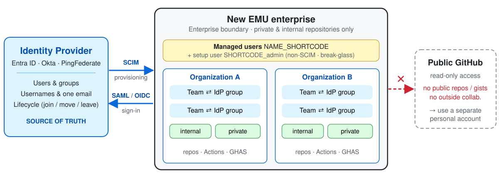
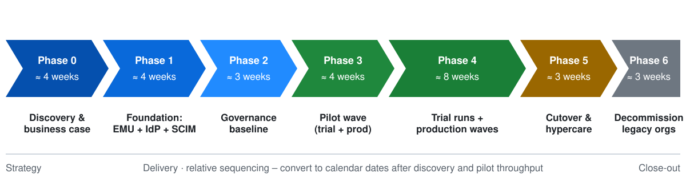
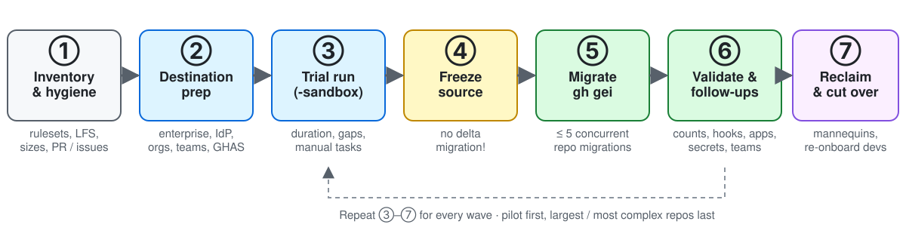

<!--
_class: title
_paginate: false
_header: ""
_footer: ""
-->


# Migrating from GitHub.com to **GitHub Enterprise Managed Users (EMU)**

<div class="sub">Why, how and what to watch out for – a one-hour walkthrough of the technical, identity, governance and change-management aspects.</div>

<a class="btn" href="https://github.com/frkim/GitHub-EMU">github.com/frkim/GitHub-EMU</a>

<div class="meta">60-minute session · slides are generated from the Markdown guides in the repository · last verified against GitHub Docs: 2026-10-15</div>

<!--
Welcome everyone. This session is a 60-minute condensed version of the repository guides. Everything in the deck traces back to a document in /docs, so you can dig deeper afterwards.
Timing plan is on the next slide. Keep ~5 minutes at the end for questions.
-->

---

# Agenda – 60 minutes

| # | Topic | Min | Start |
|---|---|---:|---:|
| 0 | Opening & objectives | 3 | 0:00 |
| 1 | **Why EMU?** The problem, the benefits, the trade-offs | 7 | 0:03 |
| 2 | **EMU fundamentals & decision guide** | 7 | 0:10 |
| 3 | **Strategy & planning** – program, waves, roadmap | 7 | 0:17 |
| 4 | **Identity & access** – IdP, SCIM, usernames, teams | 7 | 0:24 |
| 5 | **Governance, security & compliance** | 6 | 0:31 |
| 6 | **Technical migration** with GitHub Enterprise Importer | 9 | 0:37 |
| 7 | **Post-migration & change management** | 4 | 0:46 |
| 8 | **Pitfalls & mitigations** | 3 | 0:50 |
| 9 | Wrap-up, next steps | 2 | 0:53 |
| 10 | Q&A | 5 | 0:55 |

<!--
Stick to the timing – the sections map 1:1 to docs 01–08 in the repository. The checklist in /checklists ties everything together.
-->

---

# Objectives – what you will take away

<div class="cards">
<div class="card">


### Decide
Understand what EMU is, what it changes, and whether it fits **your** organization.

</div>
<div class="card">


### Plan
A phased roadmap with waves, trial runs, gates and KPIs – not a settings toggle.

</div>
<div class="card">


### Execute safely
Identity first, governance baseline, GEI runbook, follow-up tasks and hypercare.

</div>
</div>

> **Key message:** EMU is a **migration program**, not a configuration change – an existing enterprise with personal accounts cannot be converted in place.

<!--
Set expectations: this is about moving from GitHub.com organizations / enterprise with personal accounts to a NEW EMU enterprise. Hosting can be github.com or GHE.com (data residency).
-->

---

<!--
_class: divider
_paginate: false
-->

<div class="num">1</div>

# Why migrate to EMU?

<div class="lead">The problems with personal accounts, what EMU changes, and the honest trade-offs.</div>

<div class="time"><span class="pill">7 min</span> <span class="pill">0:03 → 0:10</span> <span class="pill">Doc 01</span></div>

---

# The problem: five gaps with personal accounts

<div class="cards">
<div class="card">


### Shadow identities
Users own their GitHub accounts – the enterprise only governs access to its organizations.

</div>
<div class="card">


### Offboarding gaps
Leaving employees keep a personal account; deprovisioning is delayed or incomplete.

</div>
<div class="card">


### No username / email authority
The enterprise cannot enforce naming, profile data or commit email.

</div>
<div class="card">


### Leakage path
The same account can publish publicly or collaborate outside the company.

</div>
<div class="card">


### Inconsistent boundaries
Policies, residency and audit differ from org to org.

</div>
<div class="card" style="background:#ddf4ff;border-color:#54aeff">


### EMU's answer
Move **account lifecycle and sign-in authority** to your identity provider.

</div>
</div>

<!--
Walk through each gap with a real-world example if you have one: orphaned accounts after layoffs, people committing with personal emails, accidental public forks of private code.
-->

---

<!--
_class: fit-diagram
-->

# What EMU is – the IdP is the source of truth



<!--
Key points: (1) the IdP provisions accounts with SCIM; (2) users authenticate on the IdP with SAML or OIDC; (3) the IdP controls usernames, profile data, org membership and repository access via groups; (4) the setup user SHORTCODE_admin is the only non-SCIM account; (5) the enterprise boundary: no public content and no outside collaboration from managed accounts. Managed users keep read-only access to public GitHub.
-->

---

# What changes at a glance

| Area | Enterprise with personal accounts | **EMU** |
|---|---|---|
| Account lifecycle | User owns the account; enterprise governs org access | **IdP provisions and deprovisions** the managed account |
| Authentication | SAML identity linked to a personal account | Always through the IdP (SAML or OIDC) |
| Provisioning | SCIM provisions org access | SCIM provisions **managed users** |
| Username & email | Not enterprise-owned | Controlled by the IdP (one email only) |
| Public & outside collaboration | Possible | **Blocked** from the managed account |
| Repo visibility in orgs | Depends on design | **Private and internal only** |
| Data residency (`ghe.com`) | Not available | **Requires EMU** |

<!--
This is the one slide to remember. It is a control-model change: authority over the account moves from the user to the enterprise.
-->

---

# Benefits of EMU

<div class="cards">
<div class="card">


### Security & lifecycle
Provision / deprovision with the same process as every other enterprise app; sessions invalidated on leave.

</div>
<div class="card">


### Compliance & residency
`ghe.com` regions (EU, Australia, US, Japan) – EMU is required.

</div>
<div class="card">


### Governance
Enterprise policies, teams synced from IdP groups, consistent naming.

</div>
<div class="card">


### Leak prevention
No public repos or gists from managed accounts; internal repos for **InnerSource**.

</div>
<div class="card">


### Operational efficiency
Joiner / mover / leaver automation, central audit streaming, fewer manual access reviews.

</div>
<div class="card">


### Developer experience
One sign-in through the corporate IdP; access follows group membership.

</div>
</div>

---

# The trade-offs – be honest with the business

<div class="cols">
<div>

### What developers lose
- Public repositories and gists from the managed account
- Contribution / forks / stars **outside** the enterprise
- Own password and GitHub-native 2FA
- Ability to edit name or email on GitHub
- Being visible to non-enterprise users

</div>
<div>

### What the program must absorb
- A **new enterprise** and a migration project
- Dual accounts for open-source contributors
- IdP data quality (usernames, one email)
- Items that GEI does **not** migrate
- Re-onboarding and change management

</div>
</div>

<div class="warn">

**Warning** – GitHub Docs: *EMU is not the best solution for every customer.* Most risk comes from underestimating identity, collaboration and platform restrictions – not from the copy operation.

</div>

---

# When EMU is *not* the right fit

- Developers must contribute to **public repositories** from the same account they use for internal work
- Daily work relies on broad **collaboration outside the enterprise**
- You need features that are unavailable with EMU, or currently unavailable on `ghe.com`
- Your IdP pattern is **unsupported** or operationally fragile
- You cannot tolerate migrating to a **new enterprise account**
- Developers will not accept **separate managed and personal accounts**

> **Common compromise:** EMU for internal work + a separate personal account for open source. It works – if training, account-switching guidance and controls are strong.

<!--
Ask the audience: which of these apply to us? Pause for 20 seconds. This hands over to the decision guide.
-->

---

<!--
_class: divider
_paginate: false
-->

<div class="num">2</div>

# EMU fundamentals & decision guide

<div class="lead">Hosting options, supported identity providers, what managed users can and cannot do – and the choices you cannot undo.</div>

<div class="time"><span class="pill">7 min</span> <span class="pill">0:10 → 0:17</span> <span class="pill">Doc 02</span></div>

---

# Hosting: GitHub.com vs GHE.com (data residency)

| Topic | GitHub.com with EMU | `ghe.com` with data residency |
|---|---|---|
| Enterprise type | EMU for new GitHub Enterprise Cloud enterprises | **EMU required** |
| Domain / API | GitHub.com · standard API | `SUBDOMAIN.ghe.com` · `https://api.SUBDOMAIN.ghe.com` |
| Regions | n/a | EU, Australia, US, Japan |
| Shortcode | Chosen by you, 3–8 alphanumeric, **immutable** | Random and hidden |
| Username length | Up to 39 characters incl. shortcode | Up to 30 characters |
| Marketplace | Available | **Unavailable** |
| Copilot | Business or Enterprise licence | Business or Enterprise + extra IDE auth; some features unavailable |
| Feature gaps | EMU restrictions only | EMU restrictions **plus** `ghe.com` differences |

> Validate every platform dependency (macOS runners, Maven/Gradle packages, S3 audit streaming with OIDC…) **before** choosing `ghe.com`.

---

# Supported identity providers

<div class="cols">
<div>

| IdP | Protocols |
|---|---|
| **Microsoft Entra ID** | SAML **or** OIDC (OIDC recommended) |
| **Okta** | SAML + SCIM (no OIDC) |
| **PingFederate** | SAML + SCIM (no OIDC) |

**Preferred design:** one supported partner IdP for both authentication *and* provisioning.

</div>
<div>

### Watch-outs
- Mixing Okta and Entra ID in an unsupported way
- **OIDC limit:** if several enterprises share one Entra tenant, the first can use SAML or OIDC – additional ones must use **SAML**
- Entra OIDC + Conditional Access: a migration service account may need an exemption
- Switching SAML → OIDC later has documented side effects

</div>
</div>

---

# What managed users can and cannot do

<div class="cols">
<div class="ok">

**✓ Can**
- Work in private and internal repos of the enterprise
- Read public GitHub (read-only)
- Use IdP groups → team sync
- Create GitHub Apps / OAuth apps (needs governance)
- Own private user repos (if policy allows)

</div>
<div class="warn">

**✗ Cannot**
- Create public repos or gists
- Collaborate or fork **outside** the enterprise
- Change profile name or email
- Use a GitHub password / native 2FA
- Be mentioned or invited by outside users

</div>
</div>

| Offboarding | Result |
|---|---|
| User unassigned / deactivated in the IdP | Sessions invalidated, account **suspended**, username replaced by a hash; reactivation restores the original username |

---

# Decision questionnaire – six questions

| Question | EMU signal |
|---|---|
| Do you need to **control users' GitHub accounts**? | **Yes → stronger** |
| Do you need **data residency**? | **Yes → much stronger** (`ghe.com` requires EMU) |
| Is your **IdP supported**? | No / unclear → pause and verify |
| Do you need **public repos, gists, Pages** that conflict with EMU? | Yes → weaker unless workflows are redesigned |
| Do you need **collaboration outside** from the same account? | Yes → weaker unless separate personal accounts are OK |
| Can you **tolerate the migration cost**? | No → EMU may not be practical now |

<div class="small">Run it as a workshop: for each question ask which policy drives the answer, which workflows change, whether process or separate accounts can mitigate, and who owns the dependency.</div>

---

# Decisions you cannot easily undo

| Decision | Why it matters |
|---|---|
| **Enterprise type** | Chosen *before* the enterprise is created – EMU is not a later toggle |
| **New enterprise** | An enterprise with personal accounts cannot be converted in place |
| **GitHub.com shortcode** | Fixed at setup; becomes part of every username (`name_SHORTCODE`) |
| **`ghe.com` region** | Foundational: legal posture, networking, tenant design |
| **IdP choice & pattern** | Rework can mean another migration project |
| **Username & email design** | Both come from the IdP; only one email is supported |

<div class="warn">

**Do not finalize the enterprise** until shortcode, region, IdP pattern and email strategy have named owners and written approvals.

</div>

---

<!--
_class: divider
_paginate: false
-->

<div class="num">3</div>

# Strategy & planning

<div class="lead">Program governance, discovery, waves and a phased roadmap.</div>

<div class="time"><span class="pill">7 min</span> <span class="pill">0:17 → 0:24</span> <span class="pill">Doc 03</span></div>

---

# Guiding principles

<div class="cols">
<div>

1. **Identity first** – the IdP drives lifecycle, auth, usernames and access
2. **Design for a new destination** – don't copy accidental sprawl
3. **Prefer supported patterns** – one partner IdP
4. **Separate stages** – discovery, pilot, production
5. **Trial before production** – `-sandbox` orgs
6. **Freeze during migration** – GEI has **no delta migration**

</div>
<div>

7. **Prioritize by complexity** – PR / issue volume, integrations, rulesets
8. **Plan follow-up work** – many items are not migrated
9. **Use internal visibility intentionally**
10. **Protect names early** – rename source orgs, don't delete
11. **Preserve attribution** – emails, mannequins, teams
12. **Treat change management as a workstream**

</div>
</div>

---

# Program governance & workstreams

<div class="cols">
<div>

### Steering committee
Owns **scope, funding, risk acceptance and go / no-go**. Executive sponsor, TPM, enterprise owner, identity, platform, security / compliance, legal / procurement, DevEx and engineering leaders.

### Cadence
Weekly program review · biweekly steering · pilot readiness review · **wave go / no-go** · hypercare review · quarterly governance review

</div>
<div>

| Workstream | Outcome |
|---|---|
| Identity | Auth, SCIM, team sync, account mapping |
| Platform / migration | Repeatable migration factory |
| Security & compliance | Baseline controls, hardening |
| Developer experience | Readiness, hypercare |
| Legal / procurement | Contracts, retention, legal hold |

</div>
</div>

---

# Discovery & inventory

<div class="cards">
<div class="card">

### What to inventory
Orgs, repos, teams, members, **outside collaborators**, **public repos & gists**, Pages sites, forks, Actions (secrets, runners), apps & webhooks, rulesets, LFS, packages, projects.

</div>
<div class="card">

### Identity readiness
Map personal accounts → future EMU users (CSV). Align **emails**. Pre-compute normalized usernames to find collisions before provisioning.

</div>
<div class="card">

### Size the effort
PR and issue counts are the **stronger timing signal** than repo count. Capture repo size, history, LFS and releases.

</div>
</div>

<div class="small">Sources: GitHub UI and APIs, `gh` CLI, audit log, GEI inventory reports, IdP exports.</div>

---

<!--
_class: fit-diagram
-->

# Phased roadmap



<div class="small center">Phase 0 confirm fit · 1 new enterprise + IdP · 2 governance baseline · 3 pilot · 4 waves · 5 cutover & hypercare · 6 decommission</div>

<!--
Durations are relative and come from the planning guide's Gantt. Replace them with your own after the pilot gives you measured throughput. Each phase has exit criteria / gates – see doc 03.
-->

---

# Waves: org migration vs repo migration

| | **Org migration** | **Repo migration** |
|---|---|---|
| Scope | Creates a **new** destination org, all repos at once | Selected repos, individually |
| Best fit | Source org maps 1:1 to target | Batching, filtering, consolidation |
| Scale | Up to **5,000** repos per org | Up to **5** concurrent migrations |
| Selective | No skip or batch inside the org | Fine-grained |
| Teams | Teams migrate, **membership does not** | Recreate / reconnect teams |
| Operator | Enterprise owner | Org owner or migrator |

**Wave criteria:** similar owners, integrations, runners, rulesets, collaboration model and PR / issue volume. Start the pilot low-to-medium complexity; keep the largest monorepos out of the first production wave.

---

# Success metrics (KPIs)

| KPI | What good looks like |
|---|---|
| Pilot success rate | Pilot repos / orgs complete and pass validation |
| Wave predictability | Actual duration stays near the trial-run expectation |
| Post-cutover defect volume | Falls wave over wave as runbooks mature |
| Re-onboarding completion | Users sign in and restore local access quickly |
| Team sync coverage | Target teams mapped to IdP groups where intended |
| App / webhook restoration | Critical integrations restored within the agreed SLA |
| Mannequin reclaim completion | High-value repos have reclaimed authorship |
| Security baseline & legacy shutdown | Controls restored as planned; old orgs locked on schedule |

> Don't compare waves by raw repo count – PR and issue counts are the stronger timing signal.

---

<!--
_class: divider
_paginate: false
-->

<div class="num">4</div>

# Identity & access

<div class="lead">Bootstrap the enterprise, provision users, design usernames and teams, and run the joiner-mover-leaver lifecycle.</div>

<div class="time"><span class="pill">7 min</span> <span class="pill">0:24 → 0:31</span> <span class="pill">Doc 04</span></div>

---

# Enterprise bootstrap – step by step

<div class="cols">
<div>

1. Create a **new EMU enterprise** (choose shortcode on GitHub.com)
2. Secure the **setup user** `SHORTCODE_admin`
3. Enable 2FA, save **recovery codes**, store in the password manager
4. Create a **PAT classic** (`scim:enterprise`, no expiration)
5. Configure **authentication** (SAML / OIDC)

</div>
<div>

6. Configure **SCIM provisioning**
7. Assign **test users and groups**
8. Validate sign-in, provisioning, username format, roles, team sync
9. **Only then** start broad user assignment

<div class="warn">

**Setup user = break-glass identity.** Only non-SCIM account; password reset by email does not work – contact GitHub Support.

</div>
</div>
</div>

<!--
Use an incognito/private browser window for the setup-user steps. Test the stored recovery procedure before go-live.
-->

---

# Usernames and email – design before you provision

<div class="cols">
<div>

### Username rules
- Built from the normalized SCIM `userName`, plus `_SHORTCODE`
- 39 chars max on GitHub.com, **30** on `ghe.com`
- Alphanumeric and dashes; no leading / trailing `-`, no `--`
- Collision → **409**, too long → **400**

| IdP value | GitHub.com result |
|---|---|
| `The.Octocat` | `The-Octocat_SHORT-CODE` ✓ |
| `!The.Octocat` | ✗ starts with `-` |
| `The!!Octocat` | ✗ contains `--` |

</div>
<div>

### Email rules
- The IdP provides **one** email address only
- Users cannot change name or email on GitHub
- Changing the IdP email **unlinks** past contribution history
- Signing keys are **not migrated** – re-add them

<div class="ok">

**Prepare:** inventory UPNs, pre-compute usernames, keep the shortcode short, freeze the mapping before bulk provisioning.

</div>
</div>
</div>

---

# IdP groups → teams

<div class="cols">
<div>

### What GitHub supports
- A team connects to **one** IdP group (one group → many teams is fine)
- Synced teams cannot be parent / child and cannot use *team maintainer*
- Existing manual members must be **removed first**
- Repo access is still granted **in GitHub**
- Entra: **security groups only** – no nested, no Microsoft 365 groups

</div>
<div>

### Naming pattern

| Layer | Example |
|---|---|
| Enterprise access | `gh-all-engineering` |
| Org membership | `gh-org-platform-members` |
| Team sync | `gh-team-platform-sre` |
| Privileged admin | `gh-org-platform-owners` |
| Vendor / guest | `gh-vendor-foo-repo-x` |

**Source of truth:** IdP for *membership*, GitHub for *permissions*.

</div>
</div>

---

# Joiner – mover – leaver

| Event | IdP action | GitHub result | Admin follow-up |
|---|---|---|---|
| **Joiner** | Assign EMU app + groups | Account provisioned; org / team membership added | Validate username, email, orgs, teams |
| **Mover** | Change groups / role attributes | Team and org membership reconciled | Review manual grants and exceptions |
| **Leaver** | Unassign or deactivate | Sessions invalidated, account disabled | Remove **manual** org memberships and external dependencies |
| **Rehire** | Reassign or reactivate | Account and original username restored | Re-validate least privilege |

> Manually added org members must be removed **manually**. IdP-driven members must be removed from **all** mapped groups.

---

# Automation identities & developers with two accounts

<div class="cols">
<div>

### Non-human identities
| Use case | Preferred identity |
|---|---|
| API integrations | **GitHub App** |
| Repo deploy access | Deploy key |
| Cloud deployments | **Actions OIDC** to the cloud |
| Legacy automation | Governed service account + PAT |

PAT classic only where required (e.g. GEI).

</div>
<div>

### Dual accounts
- **Managed account** → enterprise work only
- **Personal account** → public OSS and community
- Train on separate SSH keys, Git identities and browser sessions
- CLI: configure Git for multiple accounts · Web: account switcher · GCM: review account filtering
- Publish a short **workstation setup standard**

</div>
</div>

---

<!--
_class: divider
_paginate: false
-->

<div class="num">5</div>

# Governance, security & compliance

<div class="lead">A baseline you can enforce on day one – and the controls GEI does not carry over.</div>

<div class="time"><span class="pill">6 min</span> <span class="pill">0:31 → 0:37</span> <span class="pill">Doc 05</span></div>

---

# Baseline policies (excerpt)

| Policy | Recommended baseline |
|---|---|
| Repository visibility | **Private and internal only**; default to **internal** for InnerSource |
| User-namespace repos | **Block by default** – avoids shadow repos |
| Repo creation / deletion / transfer | Owners or tightly scoped admins only |
| Outside collaborator invites | **Owners only** |
| GitHub Actions | Enabled only for approved orgs · allow enterprise + selected actions · **pin to full commit SHA** · disable repo-level self-hosted runners |
| PATs | Classic only for approved migrators during migration; lifetime limits after stabilization |
| Apps | Owner approval model; restrict OAuth apps |
| Audit log streaming | **Enable before cutover** |
| GHAS | **Enable for destination orgs before migrating repos** |

---

# Rulesets, branch protection & GHAS

<div class="cols">
<div>

### Rulesets can block the migration
- Migrated history may violate destination rulesets
- Add **Repository migrations** to each ruleset's **bypass list** – narrow it afterwards
- Rulesets and tag protection rules are **not migrated**

### Branch protection
Many rules migrate; some do **not**: bypass actors, approval of most recent push, required deployments, lock branch, force-push settings…

</div>
<div>

### GHAS after migration
| Feature | Follow-up |
|---|---|
| Secret scanning | Rescan; re-apply remediation states via API |
| Code scanning | Alerts not migrated – re-run / re-upload SARIF |
| Dependabot | Re-enable; re-add encrypted secrets |

<div class="warn">

**CODEOWNERS:** `@org/team` references are not updated – review routing can silently break.

</div>
</div>
</div>

---

# Audit, network controls & compliance

<div class="cols3">
<div class="card">


### Audit log streaming
Amazon S3 · Azure Blob / Event Hubs · Datadog · Google Cloud Storage · Splunk. At-least-once delivery – **dedupe** in the SIEM. GEI does **not** migrate audit logs – preserve source evidence.

</div>
<div class="card">


### Network controls
Pick **one** primary control plane: GitHub IP allow list **or** Entra Conditional Access. Enable **SSO redirect** (default is a 404). Optional SSH certificate authority.

</div>
<div class="card">


### Compliance & residency
`ghe.com` regions: EU, Australia, US, Japan. Check feature gaps (e.g. S3-OIDC streaming, Marketplace). Confirm retention / **legal hold** for source orgs.

</div>
</div>

---

# What GEI does *not* migrate

| Gap | Governance response |
|---|---|
| Rulesets · custom properties | Recreate; plan migration bypass |
| GitHub Apps & installations · webhook secrets | Reinstall, re-approve, re-enter secrets |
| Actions secrets, variables, environments · Packages | Rebuild separately (`gh secret set`…) |
| Team membership (org migration) · teams (repo migration) | Rebuild via IdP group sync |
| Code scanning results · Dependabot alerts | Re-run, re-enable |
| User PATs · SSH keys · signing keys | Users re-establish |
| Audit logs · stars / watchers · fork relationships · run history | Preserve evidence; accept loss |

<div class="warn">

**Plan separate workstreams** for these items – otherwise the target looks incomplete after a "successful" migration.

</div>

---

<!--
_class: divider
_paginate: false
-->

<div class="num">6</div>

# Technical migration

<div class="lead">GitHub Enterprise Importer: prerequisites, trial runs, production waves and validation.</div>

<div class="time"><span class="pill">9 min</span> <span class="pill">0:37 → 0:46</span> <span class="pill">Doc 06</span></div>

---

<!--
_class: fit-diagram
-->

# Migration flow with GitHub Enterprise Importer (`gh gei`)



<!--
Tooling is the GitHub CLI extension gh-gei: gh extension install github/gh-gei. Always verify options with gh gei <command> --help. GEI has no delta migration – freeze the source.
-->

---

# What GEI migrates – and what needs care

<div class="cols">
<div>

### Migrated
Git history · pull requests · issues · milestones · commit comments · topics · autolinks · PR & merge settings · releases up to 10 GiB · attachments · user history (mannequins) · Actions **workflow files**

</div>
<div>

### Migrated with caveats
- **Webhooks** → migrated *disabled*
- **Wikis** → attachments excluded
- **Branch protections** → partial
- **Pages / repo settings** → verify
- **Teams** → membership not migrated (org migration)

</div>
</div>

> Compare counts and sample content after every trial and wave: repos, branches, PRs, issues, releases, wikis, settings, access.

---

# Prerequisites & access

<div class="cols">
<div>

1. **New destination enterprise** (GitHub.com EMU or GHE.com EMU)
2. IdP pattern confirmed · setup user secured
3. **Classic PATs only** – fine-grained PATs are not supported by GEI
4. **SSO-authorize** PATs when SAML SSO is enabled
5. Org owner or **migrator role** in source *and* destination
6. Sandbox orgs (`ORG-sandbox`) for trial runs
7. Planned **freeze window**

</div>
<div>

| Use | Classic PAT scopes |
|---|---|
| Source repo migration | `admin:org`, `repo` |
| Destination (owner) | `repo`, `admin:org`, `workflow` |
| Destination (migrator) | `repo`, `read:org`, `workflow` |
| Org migration | `read:enterprise`, `admin:org`, `repo`, `workflow` |
| Reclaim mannequins | `admin:org` |

<div class="warn">

If the org restricts classic PATs, **GEI is blocked** until the policy changes.

</div>
</div>
</div>

---

# Trial run – rehearse everything

<div class="cols">
<div>

1. Pick representative repos or a representative org
2. Create a sandbox org (`ORG-sandbox`) configured like production
3. Export the pre-migration inventory
4. Set `GH_SOURCE_PAT` and `GH_PAT`
5. Generate and **review** the script
6. Run the trial; validate counts, settings, access, warnings
7. Rehearse manual tasks – hooks, apps, team sync, LFS, mannequins
8. Schedule production **soon after** the trial

</div>
<div>

```bash
gh gei generate-script \
  --github-source-org SOURCE \
  --github-target-org DEST-SANDBOX \
  --output gei-trial.ps1
```

```bash
# GHE.com variant
gh gei generate-script \
  --github-source-org SOURCE \
  --github-target-org DEST-SANDBOX \
  --output gei-trial.ps1 \
  --target-api-url https://api.SUBDOMAIN.ghe.com
```

**Goals:** prove the workflow, measure duration, surface manual work.

</div>
</div>

---

# Production run – repository migration

<div class="cols">
<div>

**1. Freeze** merges, pushes, rulesets, hooks and app changes
**2. Confirm** auth, PAT scopes, SSO authorization
**3. Generate & edit** the script for the exact wave
**4. Queue** migrations – **≤ 5 concurrent**
**5. Wait** and monitor
**6. Abort** only when necessary
**7. Download logs** and complete the follow-ups

</div>
<div>

```bash
gh gei migrate-repo \
  --github-source-org SOURCE --source-repo REPO \
  --github-target-org DEST --target-repo REPO \
  --queue-only

gh gei wait-for-migration
gh gei download-logs
```

```bash
# Organization migration (enterprise owner)
gh gei migrate-org \
  --github-source-org SOURCE \
  --github-target-org DEST \
  --github-target-enterprise ENTERPRISE_SLUG
```

</div>
</div>

<div class="small">Always confirm exact options with <code>gh gei &lt;command&gt; --help</code>. Never commit tokens – use <code>GH_PAT</code> / <code>GH_SOURCE_PAT</code> environment variables.</div>

---

# After the copy – the follow-up tasks

<div class="cards">
<div class="card">

### Re-enable & restore
- **Webhooks** (disabled → re-add secrets)
- **GitHub Apps** (reinstall)
- **Actions** secrets, variables, environments, runners
- Git **LFS** check

</div>
<div class="card">

### Access & identity
- Teams & **IdP group sync**
- Rulesets & branch protection gaps
- **CODEOWNERS** references
- Signing keys, SSH keys, PATs

</div>
<div class="card">

### Attribution
- Generate the **mannequin CSV**
- Reclaim to EMU users:

```bash
gh gei reclaim-mannequin \
  --github-target-org DEST \
  --csv FILE.csv
```

</div>
</div>

<div class="small">Mannequins are placeholder identities for migrated activity other than Git commits. Only org owners can reclaim; the target user must already be an org member. For EMU, single reclaims can use <code>--skip-invitation</code>.</div>

---

<!--
_class: divider
_paginate: false
-->

<div class="num">7</div>

# Post-migration & change management

<div class="lead">Cutover, validation, developer re-onboarding, hypercare and decommissioning.</div>

<div class="time"><span class="pill">4 min</span> <span class="pill">0:46 → 0:50</span> <span class="pill">Doc 07</span></div>

---

# Cutover, validation & re-onboarding

<div class="cols">
<div>

### Cutover runbook
| When | Focus |
|---|---|
| **T-10 → T-5 days** | Scope, owners, inventory deltas, staffing, trial findings |
| **T-4 → T-2 days** | PAT / SSO validity, IP allow list, CAP exceptions, comms |
| **T-1 day** | Freeze announcement, pause automations, record hooks and apps |
| **T-0** | Freeze → final migration → review logs → announce |

Define up front: when the **destination becomes system of record**, when integrations are restored, when hypercare starts and ends.

</div>
<div>

### Developer day one
- Sign in via the **IdP** (new account)
- Update Git remotes to the new org URL
- Credentials / Git Credential Manager
- Re-add SSH & signing keys
- Two accounts for open source – use the right one

### Hypercare
War room · office hours · FAQ · ticket triage · **daily checkpoint**

</div>
</div>

---

# Decommissioning the legacy organizations

1. Confirm destination repos and integrations are **stable**
2. Reduce legacy write access per the approved shutdown plan
3. **Lock / archive** source repos and orgs
4. Remove personal-account memberships that should no longer retain access
5. Preserve or export records required by policy (audit logs are not migrated)
6. **Rename** source orgs to reuse names – don't delete (org and user names share a namespace)
7. Delete only when **legal, retention and supportability** questions are cleared

> Keep the source read-only until hypercare is complete – it is your best rollback and audit reference.

---

<!--
_class: divider
_paginate: false
-->

<div class="num">8</div>

# Pitfalls & mitigations

<div class="lead">The ten risks executives should care about – and the first control to demand for each.</div>

<div class="time"><span class="pill">3 min</span> <span class="pill">0:50 → 0:53</span> <span class="pill">Doc 08</span></div>

---

<!--
_class: dense
-->

# Top 10 pitfalls (executive view)

| # | Pitfall | First control to require |
|---:|---|---|
| 1 | Expecting an in-place EMU conversion | Require a **net-new enterprise** and migration plan |
| 2 | Ignoring public-collaboration limits | Outside-collaboration assessment |
| 3 | Commit-email mismatch | Commit-email readiness review |
| 4 | Team membership not migrated | IdP-to-team mapping as a **hard gate** |
| 5 | Conditional Access blocks migration or tooling | CAP-exempt migration service account |
| 6 | No delta migration | Enforce a **source freeze window** |
| 7 | Major features outside GEI scope | Fund separate workstreams |
| 8 | Actions context not migrated | App and pipeline rehearsal in sandbox |
| 9 | Timeline underestimated | Base estimates on **PR / issue history**, not repo count |
| 10 | Source decommissioned too early | Keep source read-only until hypercare ends |

---

# Pre-mortem – ask before approving production cutover

<div class="cols">
<div>

- Do we accept that EMU needs a **new enterprise**?
- Is the **shortcode** approved by identity, branding and platform?
- Is the **IdP pattern** supported (no unsupported Okta + Entra mix)?
- Have we tested the **setup user**, recovery codes and SCIM PAT?
- Did we inventory **public repos, gists, Pages, OSS workflows**?

</div>
<div>

- Are **classic PATs** allowed and SSO-authorized?
- Is the migration account **exempt from Conditional Access**?
- Did we document **protections, rulesets, hooks, apps, secrets, packages, projects, properties**?
- Which repos use **LFS** or oversized assets?
- Repo or org migration per wave – and does it match batching?

</div>
</div>

<div class="ok">

**Rule of thumb:** if you cannot answer one of these questions, you are not ready for that wave.

</div>

---

<!--
_class: divider
_paginate: false
-->

<div class="num">9</div>

# Wrap-up & next steps

<div class="lead">The 30-60-90 day roadmap and the five things to remember.</div>

<div class="time"><span class="pill">2 min</span> <span class="pill">0:53 → 0:55</span></div>

---

# 30 – 60 – 90 days after cutover

<div class="cards">
<div class="card">

### First 30 days
- Owners, billing & security managers in place
- Visibility, creation, forking, PAT and Actions baselines
- **Audit streaming** on, GHAS enabled
- Recreate rulesets, properties, apps, secrets, webhooks
- Reclaim mannequins, restore teams

</div>
<div class="card">

### Days 31 – 60
- Move manual access to **IdP groups**
- Tighten Actions allow-list and SHA pinning
- Reduce classic PAT usage
- Re-assess guest / collaborator grants
- Publish governance repo with CODEOWNERS and exception process

</div>
<div class="card">

### Days 61 – 90
- SSH CA if required
- Move automation to **GitHub Apps / OIDC**
- Expand security configurations
- Audit org deviations from baseline
- Legal-approved retirement of source orgs

</div>
</div>

---

# Key takeaways

<div class="cards two">
<div class="card">


### 1 · It is a program
EMU needs a **new enterprise**. Sponsor, fund and govern it like one.

</div>
<div class="card">


### 2 · Identity first
Shortcode, IdP, usernames, **one email**, groups – decide and test before moving code.

</div>
<div class="card">


### 3 · Trial, freeze, migrate
No delta migration. Rehearse in `-sandbox`, freeze, then run in waves.

</div>
<div class="card">


### 4 · Plan the gaps
Secrets, apps, hooks, rulesets, teams, mannequins – budget the follow-up work.

</div>
</div>

<div class="center" style="margin-top:0.5em">

**5 · Invest in developers** – dual accounts, re-onboarding, communications and hypercare decide adoption.

</div>

---

<!--
_class: closing
_paginate: false
-->

# Resources & questions

<div class="cols">
<div>

<a class="btn" href="https://github.com/frkim/GitHub-EMU">github.com/frkim/GitHub-EMU</a>

| Repository content | |
|---|---|
| `docs/01 … 09` | The nine guides behind this deck |
| `checklists/migration-checklist.md` | Gated end-to-end checklist |
| `presentation/` | This deck (Marp) |

<div class="small" style="color:#8b949e">Official docs: <a href="https://docs.github.com/en/enterprise-cloud@latest/admin/managing-iam/understanding-iam-for-enterprises/about-enterprise-managed-users">About Enterprise Managed Users</a> · <a href="https://docs.github.com/en/migrations/using-github-enterprise-importer">GitHub Enterprise Importer</a></div>

</div>
<div class="center">


<div class="small" style="color:#8b949e">Scan to open the repository</div>

</div>
</div>

<span class="pill">5 min Q&amp;A</span> <span class="pill">0:55 → 1:00</span>

<!--
Open the floor for questions. Point people to the checklist as the first concrete next step: run section 1 (decision & business case) as a workshop.
-->
